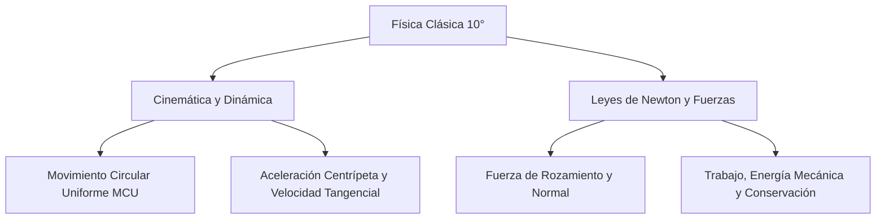

# 📝 Ley de ohm y circuitos

> [!INFO] **Ficha de la Asignación Académica**
> * **Materia:** [[Materia - Física|Física]]
> * **Docente:** `Docente Titular`
> * **Fecha Límite / Registro:** `Clase, martes 13 octubre 06:45`
> * **Estado:** **🔴 Atrasadas (Semana pasada)**
> * **Portal Phidias:** [Ver en Phidias](https://liceomodernocf.phidias.co/academic/assignment/details?assignment=11987&person=2046&_ach=8edd284465cea2bb5e156f1935106fda)
> * **Libro Guía Santillana:** [[Santillana - Física 10°]] (`Guía Oficial Circuitos.pdf + Consulta Ley de Ohm`)

---

## 📌 1. Instrucciones del Docente
Ley de ohm y circuitos
1. Consultar qué es un circuito en serie, mixto y paralelo, describir las caracteristicas y un dibujo de cada circuito.
2. ¿Qué es corriente alterna y corriente directa?
3. ¿Cuáles son los principales instrumentos utilizados en un circuito y para qué sirven?
4. ¿Qué sucede si un elemento que ofrece resistencia al paso de la corriente cambia de forma o tamaño?
5. ¿Qué es un material conductor y aislante? Mencione 5 ejemplos para cada uno

---

## 📖 2. Fundamentación Curricular Santillana UNOi
* **Texto Guía:** [[Santillana - Física 10°|Santillana UNOi — Competencias Científicas 10° (Componente Físico)]]
* **Unidad Temática:** Electrodinámica: Ley de Ohm y Circuitos Eléctricos (Serie, Paralelo y Mixto)
* **Páginas del libro físico:** **Guía Oficial Circuitos.pdf + Consulta Ley de Ohm**
* **Conceptos clave aplicados:** Ley de Ohm (V = I·R), resistencia equivalente en serie (Req = R1+R2+...) y en paralelo (1/Req = 1/R1+1/R2+...), corriente directa (DC) y alterna (AC), instrumentos de medición (amperímetro, voltímetro, óhmetro, multímetro), resistividad (R = ρ·L/A) y materiales conductores vs. aislantes.

---

## ✍️ 3. Solución Estudiantil Completa
*(Redactado en voz auténtica de estudiante, respetando el formato solicitado y con rigor conceptual).*

**Estudiante:** Julian Camilo Monroy Rozo | **Grado:** 10° | **Asignatura:** Física Décimo | **Actividad:** Consulta: Ley de Ohm y Circuitos Eléctricos (5 Puntos del Profesor)

---

### Desarrollo Completo de la Consulta de Física: Ley de Ohm y Circuitos Eléctricos

Respondo en estricto orden numérico las **5 preguntas formuladas por el profesor en el Aula de Phidias**:

---

#### **1. Consultar qué es un circuito en serie, mixto y paralelo, describir las características y hacer el esquema de cada circuito.**
* **Circuito en Serie:** Es aquel donde los receptores o resistencias se conectan secuencialmente formando un solo camino para los electrones. *Características:* La intensidad de corriente es la misma en todos los elementos ($I_T = I_1 = I_2$), el voltaje de la fuente se reparte ($V_T = V_1 + V_2$), la resistencia equivalente es $R_{eq} = R_1 + R_2 + \dots + R_n$, y si un bombillo se funde, se abre el circuito y se apagan todos los demás.
  ```text
     + [ Batería V ] - ───► I ───[ R1 ]────[ R2 ]────[ R3 ]───┐
       ▲                                                      │
       └──────────────────────────────────────────────────────┘
  ```
* **Circuito en Paralelo:** Es aquel donde todas las entradas de las resistencias se unen a un nodo común y todas las salidas a otro nodo común, creando varios caminos independientes. *Características:* El voltaje es idéntico en todas las ramas ($V_T = V_1 = V_2$), la corriente se divide según cada resistencia ($I_T = I_1 + I_2$), la resistencia total es menor que la menor de las resistencias ($\frac{1}{R_{eq}} = \frac{1}{R_1} + \frac{1}{R_2}$), y si un bombillo se daña, los demás siguen encendidos normalmente (como en las instalaciones eléctricas de nuestras casas).
  ```text
                     ┌────[ R1 ]────┐
     + [ Batería V ] ┼────[ R2 ]────┼─── Regreso (-)
                     └────[ R3 ]────┘
  ```
* **Circuito Mixto:** Es el que combina conexiones en serie y conexiones en paralelo dentro de un mismo circuito eléctrico. Se resuelve reduciendo por partes los subcircuitos serie y paralelo usando la Ley de Ohm ($V = I \cdot R$).
  ```text
                               ┌────[ R2 ]────┐
     + [ Batería V ] ──[ R1 ]──┤              ├─── Regreso (-)
                               └────[ R3 ]────┘
  ```

---

#### **2. ¿Qué es corriente alterna (AC) y corriente directa o continua (DC)?**
* **Corriente Directa o Continua (DC / CC):** Es el flujo de cargas eléctricas (electrones) que se desplaza siempre en **un mismo sentido constante** y con polaridad fija (de polo negativo a polo positivo) a través del conductor. Es la que suministran las **pilas, baterías de celulares, baterías de automóviles y paneles solares**.
* **Corriente Alterna (AC / CA):** Es aquella en la que la magnitud y el sentido del flujo de electrones **cambian periódicamente de forma senoidal** (en Colombia oscila a una frecuencia de **$60\text{ Hz}$**, invirtiendo su sentido 120 veces por segundo). Es la que llega a los tomacorrientes de nuestras casas ($110\text{–}120\text{ V}$) porque permite transportar la energía eléctrica a grandes distancias desde las hidroeléctricas usando transformadores con mínimas pérdidas de calor.

---

#### **3. ¿Cuáles son los principales instrumentos utilizados en un circuito eléctrico y para qué sirven?**
1. **Amperímetro:** Mide la **intensidad de corriente eléctrica ($I$)** en **Amperios ($\text{A}$)**. Se debe conectar siempre **en serie** con el elemento por donde queremos medir el paso de corriente.
2. **Voltímetro:** Mide la **diferencia de potencial o tensión eléctrica ($V$)** entre dos puntos en **Voltios ($\text{V}$)**. Se debe conectar siempre **en paralelo** con el elemento o fuente a medir.
3. **Óhmetro:** Mide la **resistencia eléctrica ($R$)** de un componente o conductor en **Ohmios ($\Omega$)** (con el circuito desconectado de la fuente).
4. **Multímetro (o Polímetro):** Instrumento portátil que integra en un solo equipo el voltímetro, el amperímetro y el óhmetro tanto para corriente continua como alterna.
5. **Vatímetro:** Mide la **potencia eléctrica activa ($P$)** consumida por un circuito en **Vatios ($\text{W}$)**.

---

#### **4. ¿Qué sucede si un elemento que ofrece resistencia al paso de la corriente cambia de forma o tamaño?**
La oposición que presenta un conductor cilíndrico al paso de la corriente depende de su material y de su geometría según la **Ley de Pouillet (fórmula de la resistividad eléctrica)**:
$$R = \rho \cdot \frac{L}{A}$$
Donde $R$ es la resistencia en ohmios ($\Omega$), $\rho$ es la resistividad propia del material ($\Omega\cdot\text{m}$), $L$ es la **longitud** del conductor y $A$ es el **área de su sección transversal (grosor)**:
* **Si aumenta la longitud ($L$) del cable (se hace más largo):** La resistencia eléctrica **aumenta de forma directamente proporcional**, porque los electrones deben recorrer más distancia chocando contra más átomos de la red cristalina.
* **Si aumenta el grosor o área transversal ($A$) del cable (se hace más grueso):** La resistencia eléctrica **disminuye de forma inversamente proporcional**, porque los electrones disponen de un canal más ancho para fluir con menor oposición.

---

#### **5. ¿Qué es un material conductor y un material aislante? Mencione 5 ejemplos para cada uno.**
* **Material Conductor:** Es aquel cuyos átomos poseen **electrones libres en su banda de valencia** débilmente ligados al núcleo, lo que permite que las cargas eléctricas se desplacen con gran facilidad y bajísima resistividad cuando se aplica una diferencia de potencial.
  * **5 ejemplos de conductores:** 1) **Plata ($\text{Ag}$)**, 2) **Cobre ($\text{Cu}$)** (usado en los cables eléctricos), 3) **Oro ($\text{Au}$)**, 4) **Aluminio ($\text{Al}$)** (usado en redes de alta tensión) y 5) **Agua salada (solución electrolítica de $\text{NaCl}$)**.
* **Material Aislante (o Dieléctrico):** Es aquel cuyos electrones están fuertemente unidos a sus enlaces químicos (alta resistividad), impidiendo el paso libre de la corriente eléctrica, por lo que se usan para recubrir cables y proteger a las personas de descargas eléctricas.
  * **5 ejemplos de aislantes:** 1) **Caucho / Goma**, 2) **Plástico (PVC)**, 3) **Vidrio**, 4) **Porcelana / Cerámica** (usada en los aisladores de postes eléctricos) y 5) **Madera seca**.

---

## 💡 4. Apuntes para Defensa Oral en Clase
### 💡 Resumen Exprés para Clase
1. **Diferencia clave serie vs paralelo:** En el circuito en serie la corriente es la misma y si se apaga un foco se apaga todo; en el paralelo el voltaje es igual en cada rama y si falla un componente los demás siguen funcionando.
2. **Uso de instrumentos:** El voltímetro siempre se conecta en paralelo para medir la caída de voltaje, mientras que el amperímetro se conecta en serie para medir la corriente sin interrumpir el flujo.
3. **Efecto de la geometría en la resistencia:** Un cable más largo aumenta la resistencia eléctrica, mientras que un cable más grueso (mayor área) disminuye la resistencia facilitando el paso de los electrones.

---
## ⚡ Mapa Mental Conceptual (Mermaid)


---
## 📁 Archivos de Entrega
* 📄 **Documento Word formal listo para imprimir o enviar:** `Entrega_Física_Ley de ohm y circuitos.docx` *(Disponible en carpeta `entregas_listas`)*

* 🔗 **Navegación:**
  * [[00 - 🎯 Dashboard Académico General|← Volver al Dashboard Central]]
  * [[Materia - Física|Ver todas las asignaciones de Física]]
