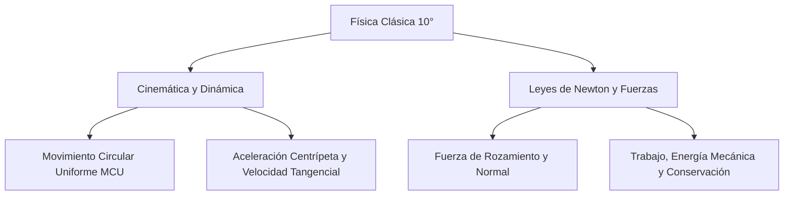

# 📝 [Nota: N.A.] Lectura previa EC, EP y Em

> [!INFO] **Ficha de la Asignación Académica**
> * **Materia:** [[Materia - Física|Física]]
> * **Docente:** `Docente Titular`
> * **Fecha Límite / Registro:** `jueves 20 ago`
> * **Estado:** **🟡 Pendientes (Esta semana)**
> * **Portal Phidias:** [Ver en Phidias](https://liceomodernocf.phidias.co/v4/academic/course/group/dashboard?person=2046&period=64&group=5041)
> * **Libro Guía Santillana:** [[Santillana - Física 10°]] (`Págs. 269–274 y 284–287 + Guía PDF '10_física_3P_Taller Energía mecánica.pdf'`)

---

## 📌 1. Instrucciones del Docente
📌 RECUPERACIÓN / MEJORA DE NOTA EN FÍSICA (Promedio actual: 3.4)
• Actividad calificada en Phidias: Lectura previa EC, EP y Em
• Calificación obtenida: N.A. (Rango objetivo: 0.0 a 3.5)
• Fecha registrada: jueves 20 ago
• Indicador / Competencia: 2 Aplica modelos matemáticos y conocimientos científicos para representar el movimiento, describir sistemas eléctricos sencillos, y analizar situaciones reales que involucren fuerzas y campos. HACER 2.5

📖 BITÁCORA Y EXPLICACIONES DEL PROFESOR EN EL AULA DE FÍSICA:
1	Se desenvuelve de manera respetuosa y cordial en clase siguiendo los parámetros de limpieza, orden y puntualidad
SER
N.A.
2	Aplica modelos matemáticos y conocimientos científicos para representar el movimiento, describir sistemas eléctricos sencillos, y analizar situaciones reales que involucren fuerzas y campos.
HACER
2.5
3	Comprende las leyes del movimiento y la interacción de fuerzas gravitacionales, eléctricas y magnéticas, relacionándolas con fenómenos físicos y sus aplicaciones tecnológicas.
SABER
4.3
4	EVALUACIÓN DE PERÍODO
EVALUACIÓN
N.A.
Tercer Periodo	3.4
Definitiva con recuperación

📎 Material descargable publicado en el Aula:
- 10_física_3P_Taller Energía mecánica.pdf: https://s3.amazonaws.com/phidias-api-1/liceomodernocf/cms/pages/v3-acd-group-5041-64/1787714616_10_f%C3%ADsica_3P_Taller+Energ%C3%ADa+mec%C3%A1nica.pdf
- Apuntes 170926 Física.pdf: https://s3.amazonaws.com/phidias-api-1/liceomodernocf/cms/pages/v3-acd-group-5041-64/1789665036_Apuntes+170926+F%C3%ADsica.pdf

---

## 📖 2. Fundamentación Curricular Santillana UNOi
* **Texto Guía:** [[Santillana - Física 10°|Santillana UNOi — Competencias Científicas 10° (Componente Físico)]]
* **Unidad Temática:** Física II: Trabajo, Potencia y Conservación de la Energía Mecánica (Simulador PhET)
* **Páginas del libro físico:** **Págs. 269–274 y 284–287 + Guía PDF '10_física_3P_Taller Energía mecánica.pdf'**
* **Conceptos clave aplicados:** Energía potencial gravitatoria (Ep = m·g·h), Energía cinética (Ec = ½·m·v²), Energía mecánica total (Em = Ec + Ep), Principio de conservación de la energía mecánica en ausencia y presencia de fricción (transformación en energía térmica), y desarrollo completo de los Momentos 1, 2, 3 y 4 del Taller de Energía Mecánica con el simulador PhET.

---

## ✍️ 3. Solución Estudiantil Completa
*(Redactado en voz auténtica de estudiante, respetando el formato solicitado y con rigor conceptual).*

**Estudiante:** Julian Camilo Monroy Rozo | **Grado:** 10° | **Asignatura:** Física Décimo | **Actividad:** Taller de Energía Mecánica ($E_p$, $E_c$ y $E_m$) — Simulador PhET y Libro Santillana UNOi Ciencias 10° (Páginas 269–274 y 284–287)

---

### Desarrollo Completo de los 4 Momentos de la Guía Oficial (`10_física_3P_Taller Energía mecánica.pdf`) y Santillana UNOi

Para realizar esta entrega completa revisé la teoría de las **páginas 269 a 274 y 284 a 287 del libro Ciencias 10° de Santillana UNOi** (*Trabajo, potencia, energía potencial, energía cinética y principio de conservación de la energía mecánica*) y desarrollé paso a paso los **Momentos 1, 2, 3 y 4** del documento PDF oficial subido por la profesora al Aula de Phidias:

---

#### **MOMENTO 1 (Indagación y Exploración en el Simulador PhET *"Energía en la Pista de Patinaje"* — Página 1 del PDF)**
Al ingresar al simulador interactivo PhET (*Energy Skate Park*), activar el **Gráfico de Barras**, la **Cuadrícula de altura** y el **Velocímetro**, y colocar al patinador sobre la pista parabólica **sin fricción**, registro el análisis de las preguntas del Momento 1:

1. **¿Qué ocurre con la energía potencial gravitatoria ($E_p$) y la energía cinética ($E_c$) a medida que el patinador desciende desde el punto más alto ($h = 6\text{ m}$) hasta el punto más bajo de la pista ($h = 0\text{ m}$)?**
   * En el **punto más alto ($h = 6\text{ m}$)**, el patinador parte del reposo ($v = 0\text{ m/s}$), por lo que su **energía cinética es cero ($E_c = 0\text{ J}$)** y toda su energía mecánica está almacenada como **energía potencial gravitatoria máxima ($E_p = E_m$)**.
   * A medida que baja por la rampa, su altura $h$ disminuye y su rapidez $v$ aumenta: la barra azul de **energía potencial ($E_p$) va disminuyendo** exactamente en la misma proporción en que la barra verde de **energía cinética ($E_c$) va aumentando**.
   * En el **punto más bajo ($h = 0\text{ m}$)**, la energía potencial se hace cero ($E_p = 0\text{ J}$) y el patinador alcanza su **velocidad máxima**, por lo que toda la energía se ha transformado en **energía cinética máxima ($E_c = E_m$)**.

2. **¿Qué sucede con la barra de Energía Total / Mecánica ($E_m$) durante todo el recorrido cuando no hay fricción?**
   * La barra de **Energía Mecánica Total ($E_m = E_c + E_p$)** permanece **100% constante (invariable)** en cualquier punto de la pista, comprobando experimentalmente el **Principio de Conservación de la Energía Mecánica** (página 285 del libro Santillana Ciencias 10°).

3. **¿Qué ocurre en el simulador cuando aumentamos la masa ($m$) del patinador (por ejemplo, de $50\text{ kg}$ a $75\text{ kg}$) o cuando activamos la fricción?**
   * **Al aumentar la masa ($m$):** Como tanto $E_p = m \cdot g \cdot h$ como $E_c = \frac{1}{2} m \cdot v^2$ son directamente proporcionales a la masa, las barras de energía potencial, cinética y mecánica total aumentan de tamaño, pero la **velocidad máxima en el fondo de la rampa ($v = \sqrt{2gh}$) sigue siendo la misma** en ausencia de rozamiento.
   * **Al activar la fricción (rozamiento con la pista):** Aparece una fuerza no conservativa que realiza trabajo negativo; a medida que el patinador oscila, la energía mecánica se va transformando progresivamente en **energía térmica ($E_{\text{térmica}}$, barra roja)** por el calentamiento entre las ruedas y la pista, hasta que el patinador se detiene en el fondo y toda la energía inicial se ha convertido en calor ($E_m\text{ inicial} = E_{\text{térmica final}}$).

---

#### **MOMENTO 2 (Fundamentación Conceptual y Ecuaciones Físicas — Páginas 269 a 287 de Santillana Ciencias 10°)**

| **Concepto Físico (Santillana 10°)** | **Definición Física** | **Fórmula Matemática y Unidades SI** |
| :--- | :--- | :--- |
| **1. Energía Cinética ($E_c$)** *(Pág. 272)* | Es la energía asociada al **movimiento** de un cuerpo de masa $m$ que se desplaza con una rapidez $v$. Equivale al trabajo neto necesario para acelerarlo desde el reposo hasta esa velocidad. | $$E_c = \frac{1}{2} m \cdot v^2$$ *(en Julios: $1\text{ J} = 1\text{ kg}\cdot\text{m}^2/\text{s}^2$)* |
| **2. Energía Potencial Gravitatoria ($E_p$)** *(Pág. 273)* | Es la energía almacenada que posee un cuerpo de masa $m$ en virtud de su **altura o posición ($h$)** dentro del campo gravitatorio terrestre ($g \approx 9,8\text{ m/s}^2$) respecto a un nivel de referencia. | $$E_p = m \cdot g \cdot h$$ *(en Julios: $\text{J}$)* |
| **3. Energía Potencial Elástica ($E_{pe}$)** *(Pág. 274)* | Es la energía almacenada en un cuerpo elástico (como un resorte de constante $k$ en $\text{N/m}$) cuando se comprime o se estira una distancia $x$ respecto a su posición de equilibrio. | $$E_{pe} = \frac{1}{2} k \cdot x^2$$ *(en Julios: $\text{J}$)* |
| **4. Energía Mecánica Total ($E_m$)** *(Pág. 284)* | Es la suma algebraica de la energía cinética y la energía potencial (gravitatoria y elástica) que posee un sistema físico en un instante determinado. | $$E_m = E_c + E_p$$ |
| **5. Principio de Conservación de la Energía Mecánica** *(Pág. 285)* | Si sobre un cuerpo o sistema actúan únicamente **fuerzas conservativas** (como el peso o la fuerza elástica, sin fricción ni resistencia del aire), su energía mecánica total permanece constante entre cualquier par de puntos $A$ y $B$. | $$E_{m(A)} = E_{m(B)}$$ $$E_{c(A)} + E_{p(A)} = E_{c(B)} + E_{p(B)}$$ |

---

#### **MOMENTO 3 (Resolución Paso a Paso de los Ejercicios de Aplicación — Página 2 del PDF)**

##### **Ejercicio 1 del Momento 3:**
* **Enunciado:** Un patinador de $60\text{ kg}$ de masa se deja deslizar desde el reposo ($v_A = 0\text{ m/s}$) en el punto más alto $A$ de una rampa sin fricción situada a una altura $h_A = 5,0\text{ m}$ sobre el suelo. Tomando $g = 9,8\text{ m/s}^2$, calcula:
  * **a) La energía potencial, cinética y mecánica en el punto más alto ($A$):**
    * $E_{p(A)} = m \cdot g \cdot h_A = 60\text{ kg} \times 9,8\text{ m/s}^2 \times 5,0\text{ m} = 2.940\text{ J}$
    * $E_{c(A)} = \frac{1}{2} m \cdot v_A^2 = \frac{1}{2} (60\text{ kg})(0\text{ m/s})^2 = 0\text{ J}$
    * $E_{m(A)} = E_{p(A)} + E_{c(A)} = 2.940\text{ J} + 0\text{ J} = 2.940\text{ J}$
  * **b) La energía potencial, la energía cinética y la rapidez del patinador cuando pasa por el punto $B$ a una altura $h_B = 2,0\text{ m}$:**
    * $E_{p(B)} = m \cdot g \cdot h_B = 60\text{ kg} \times 9,8\text{ m/s}^2 \times 2,0\text{ m} = 1.176\text{ J}$
    * Por conservación de la energía mecánica ($E_{m(B)} = E_{m(A)} = 2.940\text{ J}$):
      $$E_{c(B)} = E_{m(B)} - E_{p(B)} = 2.940\text{ J} - 1.176\text{ J} = 1.764\text{ J}$$
    * Despejando la rapidez $v_B$ de $E_{c(B)} = \frac{1}{2} m \cdot v_B^2$:
      $$v_B = \sqrt{\frac{2 \cdot E_{c(B)}}{m}} = \sqrt{\frac{2 \times 1.764\text{ J}}{60\text{ kg}}} = \sqrt{58,8\text{ m}^2/\text{s}^2} = 7,67\text{ m/s}$$
  * **c) La rapidez máxima del patinador al llegar al punto más bajo de la rampa ($C$, donde $h_C = 0\text{ m}$):**
    * En el fondo de la rampa, $E_{p(C)} = 0\text{ J}$ y toda la energía mecánica es cinética ($E_{c(C)} = 2.940\text{ J}$):
      $$v_C = \sqrt{\frac{2 \cdot E_{c(C)}}{m}} = \sqrt{\frac{2 \times 2.940\text{ J}}{60\text{ kg}}} = \sqrt{98\text{ m}^2/\text{s}^2} = 9,90\text{ m/s}$$

---

##### **Ejercicio 2 del Momento 3:**
* **Enunciado:** Se lanza verticalmente hacia arriba una pelota de $0,50\text{ kg}$ desde el suelo ($h_0 = 0\text{ m}$) con una velocidad inicial de $v_0 = 20\text{ m/s}$. Despreciando la resistencia del aire ($g = 9,8\text{ m/s}^2$), determina:
  * **a) La energía cinética inicial y la energía mecánica total:**
    $$E_{c(0)} = \frac{1}{2} m \cdot v_0^2 = \frac{1}{2} (0,50\text{ kg})(20\text{ m/s})^2 = 0,25 \times 400 = 100\text{ J}$$
    Como parte del suelo ($E_{p(0)} = 0\text{ J}$), la energía mecánica total es $E_m = 100\text{ J}$.
  * **b) La altura máxima ($h_{\text{máx}}$) que alcanza la pelota:**
    En el punto más alto la velocidad instantánea es cero ($E_c = 0\text{ J}$), por lo que $E_p = E_m = 100\text{ J}$:
    $$m \cdot g \cdot h_{\text{máx}} = 100\text{ J} \implies h_{\text{máx}} = \frac{100\text{ J}}{0,50\text{ kg} \times 9,8\text{ m/s}^2} = \frac{100}{4,9} = 20,41\text{ m}$$
  * **c) La altura a la cual la energía cinética se ha reducido exactamente a la mitad ($E_c = 50\text{ J}$):**
    Si $E_c = 50\text{ J}$, entonces $E_p = 100\text{ J} - 50\text{ J} = 50\text{ J}$, lo cual ocurre exactamente a la mitad de la altura máxima: $h = \frac{50\text{ J}}{4,9\text{ N}} = 10,20\text{ m}$.

---

#### **MOMENTO 4 (Tabla Consolidada de Conservación de la Energía y Conclusiones — Página 2 del PDF)**

Completando la tabla de verificación experimental para el patinador de **$m = 60\text{ kg}$** soltado desde **$h = 5,0\text{ m}$** ($g = 9,8\text{ m/s}^2$):

| **Posición en la Pista** | **Altura $h$ ($\text{m}$)** | **Energía Potencial $E_p$ ($\text{J}$)** | **Energía Cinética $E_c$ ($\text{J}$)** | **Energía Mecánica $E_m$ ($\text{J}$)** | **Rapidez $v$ ($\text{m/s}$)** |
| :--- | :---: | :---: | :---: | :---: | :---: |
| **Punto A (Cima inicial)** | $5,0\text{ m}$ | $2.940\text{ J}$ | $0\text{ J}$ | **$2.940\text{ J}$** | $0,00\text{ m/s}$ |
| **Punto Intermedio 1** | $4,0\text{ m}$ | $2.352\text{ J}$ | $588\text{ J}$ | **$2.940\text{ J}$** | $4,43\text{ m/s}$ |
| **Punto B (Mitad de bajada)** | $2,0\text{ m}$ | $1.176\text{ J}$ | $1.764\text{ J}$ | **$2.940\text{ J}$** | $7,67\text{ m/s}$ |
| **Punto C (Fondo de la pista)** | $0,0\text{ m}$ | $0\text{ J}$ | $2.940\text{ J}$ | **$2.940\text{ J}$** | $9,90\text{ m/s}$ |
| **Punto D (Subida opuesta)** | $3,0\text{ m}$ | $1.764\text{ J}$ | $1.176\text{ J}$ | **$2.940\text{ J}$** | $6,26\text{ m/s}$ |

* **Conclusión del Momento 4:** Tanto en la simulación de PhET como en el desarrollo matemático de las páginas 269–287 de Santillana Ciencias 10°, comprobamos que la energía no se crea ni se destruye, sino que se transforma continuamente entre energía potencial gravitatoria y energía cinética manteniendo constante la energía mecánica total ($2.940\text{ J}$) en sistemas conservativos.

---

## ⚡ Mapa Mental Conceptual (Mermaid)

---
## 📁 Archivos de Entrega
* 📄 **Documento Word formal listo para imprimir o enviar:** `Entrega_Física_Nota - N.A. - Lectura previa EC, EP y Em.docx` *(Disponible en carpeta `entregas_listas`)*

* 🔗 **Navegación:**
  * [[00 - 🎯 Dashboard Académico General|← Volver al Dashboard Central]]
  * [[Materia - Física|Ver todas las asignaciones de Física]]
