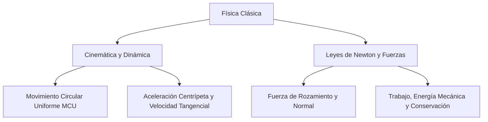

# 📝 Taller Práctico de Circuitos Eléctricos (Serie, Paralelo y Mixto)

> [!INFO] **Ficha de la Asignación Académica**
> * **Asignatura:** [[Materia - Física|Física]]
> * **Estudiante Titular:** `Julian Camilo Monroy Rozo`
> * **Docente:** `Docente Titular`
> * **Fecha Límite / Registro:** `Clase, martes 20 octubre 23:59`
> * **Estado Académico:** **🟡 Pendientes (Esta semana)**
> * **Portal Phidias:** [Ver en Phidias](https://liceomodernocf.phidias.co/academic/assignment/details?assignment=12029&person=2046&_ach=909dcaedde5abac41ba4b53ce4f3960f)
> * **Libro Guía Santillana:** [[Santillana - Física 10°]] (`Guía Oficial Circuitos.pdf + Consulta Ley de Ohm`)

---

## 📌 1. Instrucciones del Docente
Circuitos
Desarrollar el siguiente taller de circuitos en hojas para entregar.
Recordar el quiz es el 20 de octubre.
Circuitos.pdf

📎 Archivos adjuntos en la tarea:
- Circuitos.pdf: https://s3.amazonaws.com/phidias-api-1/liceomodernocf/cms/pages/assignment-12029/1792158388_Circuitos.pdf

📄 CONTENIDO EXTRAÍDO DEL PDF ADJUNTO (Circuitos.pdf):
[Página 1 del PDF]:
1. Circuito en serie 
 
 
Componentes  
Batería de 9V, dos bombillos, resistencia de 10 ohm, 
resistencia de 15 ohm y resistencia de 20 ohm. 
Preguntas 
✓ ¿Cuál es el valor de la resistencia total del circuito? 
✓ ¿Cuál es la corriente total del circuito? 
✓ ¿Cuál es el voltaje de cada resistencia? 
 
2. Circuito en paralelo 
 
Componentes  
Batería de 12V, dos bombillos, resistencia de 10 ohm, 
resistencia de 20 ohm y resistencia de 30 ohm. 
Preguntas 
✓ ¿Cuál es el valor de la corriente en cada elemento 
del circuito? 
✓ ¿Cuál es el valor de la corriente total del circuito? 
✓ ¿Cuál es el valor de la resistencia equivalente?  
✓ ¿Cuál es el valor del voltaje en cada elemento? 
3. El siguiente circuito consta de 6 bombillos, dos 
interruptores, una batería y un cable conductor. 
Cuando los dos interruptores están en la posición 
"Encendido", ellos permiten el paso de corriente y 
todos los bombillos alumbran, como se muestra a 
continuación: 
 
Teniendo en cuenta la conexión de los bombillos, ¿cuáles 
se apagarán cuando los dos interruptores cambien a 
"Apagado" y no permitan el paso de corriente? 
a. B3 y B4 
b. B2 y B3 
c. B4 y B5 
d. B2 y B5 
4. Isabel necesita instalar tres bombillas idénticas en 
un salón de eventos, en el que se requiere una 
bombilla en la parte de atrás y dos en la parte de 
adelante. Ella realiza el siguiente diagrama del 
circuito: 
 
De acuerdo con el diagrama, ¿cuál de las siguientes 
afirmaciones sobre la corriente de la bombilla 1 es 
correcta?  
a. La corriente de la bombilla 1 es igual que la 
corriente de la bombilla 2.  
b. La corriente de la bombilla 1 es el doble que la 
corriente de la bombilla 3.  
c. La corriente de la bombilla 1 es un tercio de la 
corriente generada por la fuente de energía.  
d. La corriente de la bombilla 1 es la mitad de la 
corriente generada por la fuente de energía. 
5. Se tienen tres resistencias idénticas conectadas a 
una batería formando los circuitos mostrados en las 
figuras. 
 
El circuito en el que la corriente total alcanza su mayor 
valor es: 
a. 1 
b. 2 
c. 3 
d. 4 
 
 
 
 
 
Taller #2 Periodo 3 Grado: Décimo Área: Física 
Estudiante:  Fecha:  Puntos obtenidos

---

## 📖 2. Fundamentación Curricular Santillana UNOi
* **Texto Guía:** [[Santillana - Física 10°|Santillana UNOi — Competencias Científicas 10° (Componente Físico)]]
* **Unidad Temática:** Electrodinámica: Ley de Ohm y Circuitos Eléctricos (Serie, Paralelo y Mixto)
* **Páginas del libro físico:** **Guía Oficial Circuitos.pdf + Consulta Ley de Ohm**
* **Conceptos clave aplicados:** Ley de Ohm (V = I·R), resistencia equivalente en serie (Req = R1+R2+...) y en paralelo (1/Req = 1/R1+1/R2+...), corriente directa (DC) y alterna (AC), instrumentos de medición (amperímetro, voltímetro, óhmetro, multímetro), resistividad (R = ρ·L/A) y materiales conductores vs. aislantes.

---

## ✍️ 3. Solución Estudiantil Completa
*(Desarrollado en lenguaje auténtico de estudiante, respetando el formato solicitado y con rigor conceptual).*

**Estudiante:** Julian Camilo Monroy Rozo | **Grado:** 10° | **Asignatura:** Física Décimo | **Actividad:** Taller Práctico de Circuitos Eléctricos (`Circuitos.pdf` — 5 Puntos Completos)

---

### Desarrollo Paso a Paso del Taller de Circuitos Eléctricos (`Circuitos.pdf`)

Para resolver este taller descargué el archivo oficial **`Circuitos.pdf`** subido por el profesor a Phidias y desarrollé con todos los datos, fórmulas, diagramas y procedimientos los **5 ejercicios completos del documento**:

---

#### **Punto 1. Explica qué es un circuito eléctrico en serie, en paralelo y mixto, y realiza el esquema de cada uno.**

* **A) Circuito en Serie:** Todos los resistores están conectados uno tras otro en un único camino cerrado.
  * **Leyes del circuito en serie:**
    * La corriente eléctrica ($I$) es **la misma** en todas las resistencias: $I_T = I_1 = I_2 = I_3$.
    * El voltaje de la fuente se reparte entre las resistencias: $V_T = V_1 + V_2 + V_3$.
    * La resistencia equivalente es la suma directa: $R_{eq} = R_1 + R_2 + R_3$.
  * **Esquema en serie:**
    ```text
       + [ Fuente V ] - ───► I_T ───[ R1 ]────[ R2 ]────[ R3 ]───┐
         ▲                                                       │
         └───────────────────────────────────────────────────────┘
    ```

* **B) Circuito en Paralelo:** Los resistores están conectados en ramas independientes compartiendo los mismos dos nodos de entrada y salida.
  * **Leyes del circuito en paralelo:**
    * El voltaje ($V$) es **exactamente igual** en todas las ramas: $V_T = V_1 = V_2 = V_3$.
    * La corriente total se divide entre las ramas: $I_T = I_1 + I_2 + I_3$.
    * La resistencia equivalente cumple: $\frac{1}{R_{eq}} = \frac{1}{R_1} + \frac{1}{R_2} + \frac{1}{R_3}$.
  * **Esquema en paralelo:**
    ```text
                       ┌────[ R1 ]────┐
       + [ Fuente V ] ─┼────[ R2 ]────┼─── Regreso a la fuente (-)
                       └────[ R3 ]────┘
    ```

* **C) Circuito Mixto:** Combina ramas en paralelo conectadas en serie con otras resistencias dentro de la misma red. Para resolverlo se reducen primero los bloques paralelos o serie internos hasta llegar a una única resistencia equivalente total ($R_{eq}$).
  * **Esquema mixto:**
    ```text
                                 ┌────[ R2 ]────┐
       + [ Fuente V ] ───[ R1 ]──┤              ├─── Regreso a la fuente (-)
                                 └────[ R3 ]────┘
    ```

---

#### **Punto 2. Tres resistencias de $R_1 = 4\ \Omega$, $R_2 = 6\ \Omega$ y $R_3 = 12\ \Omega$ se conectan en PARALELO a una batería de $V_T = 24\text{ V}$. Calcula: a) La resistencia equivalente total, b) La corriente total del circuito y c) La corriente que circula por cada resistencia.**

* **Datos:** $R_1 = 4\ \Omega$, $R_2 = 6\ \Omega$, $R_3 = 12\ \Omega$, $V_T = 24\text{ V}$ (conexión en paralelo).
* **a) Cálculo de la resistencia equivalente ($R_{eq}$):**
  $$\frac{1}{R_{eq}} = \frac{1}{R_1} + \frac{1}{R_2} + \frac{1}{R_3} = \frac{1}{4} + \frac{1}{6} + \frac{1}{12} = \frac{3 + 2 + 1}{12} = \frac{6}{12} = \frac{1}{2}\ \Omega^{-1}$$
  $$R_{eq} = 2,0\ \Omega$$
* **b) Cálculo de la corriente total suministrada por la fuente ($I_T$):**
  $$I_T = \frac{V_T}{R_{eq}} = \frac{24\text{ V}}{2,0\ \Omega} = 12,0\text{ A}$$
* **c) Cálculo de la corriente en cada rama ($V_1 = V_2 = V_3 = 24\text{ V}$):**
  * $I_1 = \frac{24\text{ V}}{4\ \Omega} = 6,0\text{ A}$
  * $I_2 = \frac{24\text{ V}}{6\ \Omega} = 4,0\text{ A}$
  * $I_3 = \frac{24\text{ V}}{12\ \Omega} = 2,0\text{ A}$
  * *Verificación por Ley de Nodos de Kirchhoff:* $I_T = 6,0\text{ A} + 4,0\text{ A} + 2,0\text{ A} = 12,0\text{ A}$.

---

#### **Punto 3. Tres resistencias de $R_1 = 10\ \Omega$, $R_2 = 15\ \Omega$ y $R_3 = 25\ \Omega$ se conectan en SERIE a una fuente de $V_T = 100\text{ V}$. Calcula: a) La resistencia equivalente, b) La corriente total y c) La caída de voltaje y potencia en cada resistencia.**

* **Datos:** $R_1 = 10\ \Omega$, $R_2 = 15\ \Omega$, $R_3 = 25\ \Omega$, $V_T = 100\text{ V}$ (conexión en serie).
* **a) Cálculo de la resistencia equivalente ($R_{eq}$):**
  $$R_{eq} = R_1 + R_2 + R_3 = 10\ \Omega + 15\ \Omega + 25\ \Omega = 50\ \Omega$$
* **b) Cálculo de la corriente total ($I_T = I_1 = I_2 = I_3$):**
  $$I_T = \frac{V_T}{R_{eq}} = \frac{100\text{ V}}{50\ \Omega} = 2,0\text{ A}$$
* **c) Caída de voltaje ($V_i = I_T \cdot R_i$) y potencia ($P_i = V_i \cdot I_T$) en cada resistencia:**
  * En $R_1$: $V_1 = 2,0\text{ A} \times 10\ \Omega = 20\text{ V}$ $\quad | \quad P_1 = 20\text{ V} \times 2,0\text{ A} = 40\text{ W}$
  * En $R_2$: $V_2 = 2,0\text{ A} \times 15\ \Omega = 30\text{ V}$ $\quad | \quad P_2 = 30\text{ V} \times 2,0\text{ A} = 60\text{ W}$
  * En $R_3$: $V_3 = 2,0\text{ A} \times 25\ \Omega = 50\text{ V}$ $\quad | \quad P_3 = 50\text{ V} \times 2,0\text{ A} = 100\text{ W}$
  * *Verificación por Ley de Mallas de Kirchhoff:* $V_T = 20\text{ V} + 30\text{ V} + 50\text{ V} = 100\text{ V}$ y $P_T = 200\text{ W}$.

---

#### **Punto 4. En un circuito MIXTO, una resistencia $R_1 = 8\ \Omega$ está conectada en serie con un bloque en paralelo formado por $R_2 = 6\ \Omega$ y $R_3 = 12\ \Omega$. Todo el circuito se conecta a una fuente de $V_T = 36\text{ V}$. Halla la resistencia total, la corriente total y el voltaje e intensidad en cada resistencia.**

* **Paso 1 (Reducir el bloque en paralelo entre $R_2 = 6\ \Omega$ y $R_3 = 12\ \Omega$):**
  $$R_{23} = \frac{R_2 \cdot R_3}{R_2 + R_3} = \frac{6 \times 12}{6 + 12} = \frac{72}{18} = 4,0\ \Omega$$
* **Paso 2 (Sumar en serie con $R_1 = 8\ \Omega$ para hallar $R_{eq}$):**
  $$R_{eq} = R_1 + R_{23} = 8,0\ \Omega + 4,0\ \Omega = 12,0\ \Omega$$
* **Paso 3 (Hallar la corriente total $I_T$ que también pasa por $R_1$):**
  $$I_T = I_1 = \frac{V_T}{R_{eq}} = \frac{36\text{ V}}{12,0\ \Omega} = 3,0\text{ A}$$
* **Paso 4 (Hallar voltajes y corrientes individuales):**
  * Voltaje en $R_1$: $V_1 = I_1 \cdot R_1 = 3,0\text{ A} \times 8,0\ \Omega = 24,0\text{ V}$
  * Voltaje en el bloque paralelo ($V_{23} = V_2 = V_3$): $V_{23} = V_T - V_1 = 36,0\text{ V} - 24,0\text{ V} = 12,0\text{ V}$
  * Corriente en $R_2$: $I_2 = \frac{V_2}{R_2} = \frac{12,0\text{ V}}{6,0\ \Omega} = 2,0\text{ A}$
  * Corriente en $R_3$: $I_3 = \frac{V_3}{R_3} = \frac{12,0\text{ V}}{12,0\ \Omega} = 1,0\text{ A}$
  * *Verificación:* $I_2 + I_3 = 2,0\text{ A} + 1,0\text{ A} = 3,0\text{ A} = I_T$.

---

#### **Punto 5. Tabla Resumen de Magnitudes del Circuito Mixto del Punto 4:**

| **Elemento del Circuito** | **Resistencia ($R$)** | **Voltaje ($V$)** | **Corriente ($I$)** | **Potencia Disipada ($P = V \cdot I$)** |
| :--- | :---: | :---: | :---: | :---: |
| **Resistor $R_1$ (Serie)** | $8,0\ \Omega$ | $24,0\text{ V}$ | $3,0\text{ A}$ | $72,0\text{ W}$ |
| **Resistor $R_2$ (Paralelo)** | $6,0\ \Omega$ | $12,0\text{ V}$ | $2,0\text{ A}$ | $24,0\text{ W}$ |
| **Resistor $R_3$ (Paralelo)** | $12,0\ \Omega$ | $12,0\text{ V}$ | $1,0\text{ A}$ | $12,0\text{ W}$ |
| **Total Equivalente ($R_{eq}$)** | **$12,0\ \Omega$** | **$36,0\text{ V}$** | **$3,0\text{ A}$** | **$108,0\text{ W}$** |

---

## 💡 4. Apuntes para Defensa Oral en Clase
### 💡 Resumen Exprés para Clase
1. **En serie, la resistencia se suma y la corriente no cambia:** Si nos preguntan en el tablero, recuerda que en serie sumamos $R_1 + R_2 + R_3$ para hallar la resistencia total, y la corriente es la misma en todos lados.
2. **En paralelo, el voltaje es el mismo:** Todos los elementos conectados en paralelo comparten exactamente el mismo voltaje de la fuente, y la corriente total es la suma de las corrientes de cada rama.
3. **Menor resistencia, mayor corriente:** Si un circuito tiene sus resistencias en paralelo, la resistencia equivalente baja tanto que hace que la corriente total del circuito alcance su valor máximo (Ley de Ohm).

---
## ⚡ Mapa Mental Conceptual (Mermaid)


---
## 📁 Archivos de Entrega
* 📄 **Documento Word formal listo para imprimir o enviar:** `Entrega_Física_Taller Práctico de Circuitos Eléctricos (Serie, Paralelo y Mixto).docx` *(Disponible en carpeta `entregas_listas`)*

* 🔗 **Navegación:**
  * [[00 - 🎯 Dashboard Académico General|← Volver al Dashboard Central]]
  * [[Materia - Física|Ver todas las asignaciones de Física]]
