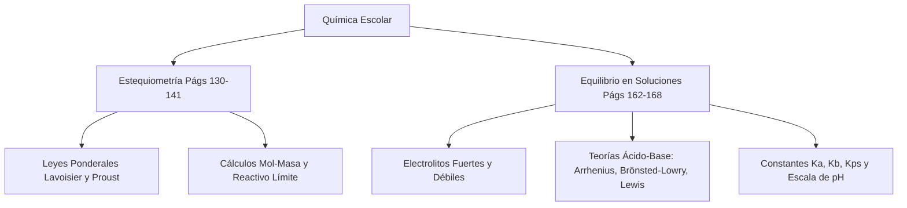

# 📝 Consulta y Ejercicios: Cálculos Estequiométricos

> [!INFO] **Ficha de la Asignación Académica**
> * **Asignatura:** [[Materia - Química|Química]]
> * **Estudiante Titular:** `Julian Camilo Monroy Rozo`
> * **Docente:** `Docente Titular`
> * **Fecha Límite / Registro:** `Clase, viernes 04 septiembre 23:59`
> * **Estado Académico:** **🔴 Atrasadas (Semana pasada)**
> * **Portal Phidias:** [Ver en Phidias](https://liceomodernocf.phidias.co/academic/assignment/details?assignment=11904&person=2046&_ach=3a992a672a9e9bef3063ad1629441b6b)
> * **Libro Guía Santillana:** [[Santillana - Química 10°]] (`Págs. 130–141`)

---

## 📌 1. Instrucciones del Docente
Debido a que durante la semana del 24 al 28 de agosto las clases de química se emplearon para realizar las sustentaciones de proyectos de semana cultural es necesario que realicen la siguiente consulta:
1) Qué son los cálculos estequiométricos y cuáles son los cuatro pasos fundamentales para hacerlos.
2) Qué es el cálculo en masa en la estequiometría.
3) Hacer 2 ejercicios de ejemplo del numeral anterior.
4) Repetir los puntos 2 y 3 para los siguientes temas:
a) Cálculo en moles
b) Cálculo mol - masa
Durante la siguiente clase se hará quiz de ejercicios relacionados. Cualquier duda, buscarme en el transcurso de la semana y preguntar.

---

## 📖 2. Fundamentación Curricular Santillana UNOi
* **Texto Guía:** [[Santillana - Química 10°|Santillana UNOi — Competencias Científicas 10° (Componente Químico)]]
* **Unidad Temática:** La estequiometría: Leyes ponderales, cálculo en masa, en moles, mol-masa y reactivo limitante
* **Páginas del libro físico:** **Págs. 130–141**
* **Conceptos clave aplicados:** La estequiometría y las leyes ponderales (Lavoisier, Proust, Dalton) (Págs. 130–131), El concepto de mol y Número de Avogadro (Págs. 132–135), Los cálculos estequiométricos y sus 4 pasos fundamentales: El cálculo en masa (Pág. 135), El cálculo en moles (Pág. 136), El cálculo en mol-masa (Pág. 136), Cálculos volumen-volumen (Pág. 137), Reactivo limitante, reactivo en exceso y rendimiento de reacción (Págs. 138–141).

---

## ✍️ 3. Solución Estudiantil Completa
*(Desarrollado en lenguaje auténtico de estudiante, respetando el formato solicitado y con rigor conceptual).*

**Estudiante:** Julian Camilo Monroy Rozo | **Grado:** 10° | **Asignatura:** Química Décimo | **Actividad:** Consulta y Ejercicios de Cálculos Estequiométricos (Páginas 130 a 141 — Santillana UNOi Ciencias 10°)

---

### Desarrollo Completo de la Consulta y Ejercicios de Estequiometría (Págs. 130–141 Santillana UNOi)

Siguiendo en estricto orden numérico los **4 numerales asignados por el profesor en Phidias** y utilizando la teoría y los métodos de las **páginas 130 a 141 del libro Ciencias 10° de Santillana UNOi** (*La estequiometría, el cálculo en masa, el cálculo en moles y el cálculo mol-masa*), desarrollo toda la actividad:

---

#### **Numeral 1. ¿Qué son los cálculos estequiométricos y cuáles son los cuatro pasos fundamentales para hacerlos?**

De acuerdo con las **páginas 130 y 135 del libro Santillana Ciencias 10°**, los **cálculos estequiométricos** son las operaciones matemáticas que nos permiten determinar las cantidades exactas (en gramos, moles, litros o número de partículas) de los **reactivos** que se consumen y de los **productos** que se forman en una reacción química, aplicando la **Ley de la Conservación de la Masa de Antoine Lavoisier** (la masa total de los reactivos es igual a la masa total de los productos) y la **Ley de las Proporciones Definidas de Joseph Proust**.

En una ecuación química ajustada, los **coeficientes estequiométricos** indican la proporción exacta en **moles** en la que reaccionan las sustancias. Según el método del factor molar explicado en el libro Santillana (pág. 135), los **cuatro (4) pasos fundamentales** para realizar cualquier cálculo estequiométrico son:

1. **Paso 1 — Escribir y balancear correctamente la ecuación química:** Verificar que exista exactamente el mismo número de átomos de cada elemento tanto en los reactivos como en los productos. Sin la ecuación balanceada no se puede hacer ningún cálculo.
2. **Paso 2 — Identificar la sustancia conocida y la sustancia deseada (incógnita), y convertir la cantidad conocida a moles:** Si el dato inicial está en gramos, se divide entre su masa molar ($\text{g/mol}$) hallada con los pesos atómicos de la tabla periódica:
   $$n = \frac{\text{masa en gramos (g)}}{\text{Masa Molar (g/mol)}}$$
3. **Paso 3 — Aplicar la relación molar (factor estequiométrico) usando los coeficientes de la ecuación balanceada:** Multiplicar los moles de la sustancia conocida por la razón estequiométrica entre los coeficientes de la ecuación ajustada:
   $$\text{Moles de la sustancia buscada} = \text{Moles conocidos} \times \left(\frac{\text{Coeficiente de la sustancia buscada}}{\text{Coeficiente de la sustancia conocida}}\right)$$
4. **Paso 4 — Convertir los moles de la sustancia buscada a la unidad solicitada por el problema:** Si el ejercicio pide el resultado en moles, el cálculo termina en el paso 3; si pide el resultado en gramos (masa), se multiplican los moles obtenidos por la masa molar ($\text{g/mol}$) de la sustancia buscada:
   $$\text{Masa (g)} = \text{Moles} \times \text{Masa Molar (g/mol)}$$

---

#### **Numeral 2. ¿Qué es el cálculo en masa (masa-masa) en la estequiometría?**

Según la **página 135 del libro Santillana Ciencias 10°** (*El cálculo en masa*), el **cálculo en masa** (o cálculo estequiométrico **masa-masa**) es aquel en el que **la cantidad conocida del problema se entrega en unidades de masa (gramos, kilogramos, etc.) y la cantidad que se desea averiguar también se pide en unidades de masa**.

Como los coeficientes de una ecuación química no relacionan gramos directamente sino **moles**, para resolver un cálculo en masa nunca se pasan los gramos directamente con los coeficientes, sino que se sigue la ruta de tres factores de conversión:
$$\text{Gramos de A (conocido)} \xrightarrow{\div \text{Masa Molar de A}} \text{Moles de A} \xrightarrow{\times \frac{\text{Coef. B}}{\text{Coef. A}}} \text{Moles de B} \xrightarrow{\times \text{Masa Molar de B}} \text{Gramos de B (buscado)}$$

---

#### **Numeral 3. Dos (2) ejercicios resueltos paso a paso de Cálculo en Masa (Masa-Masa)**

##### **Ejercicio 3.1 (Síntesis industrial de amoniaco — Proceso Haber-Bosch, Pág. 135):**
* **Enunciado:** ¿Cuántos gramos de amoniaco ($\text{NH}_3$) se producen cuando reaccionan completamente $84\text{ g}$ de nitrógeno gaseoso ($\text{N}_2$) con suficiente hidrógeno ($\text{H}_2$)?
* **Datos y masas molares:**
  * Masa conocida: $m(\text{N}_2) = 84\text{ g}$
  * Masa molar del $\text{N}_2 = 2 \times 14,0\text{ g/mol} = 28,0\text{ g/mol}$
  * Masa molar del $\text{NH}_3 = 14,0 + (3 \times 1,0) = 17,0\text{ g/mol}$
* **Paso 1 (Ecuación química balanceada):**
  $$\text{N}_2\text{ (g)} + 3\text{H}_2\text{ (g)} \longrightarrow 2\text{NH}_3\text{ (g)}$$
  *(Relación estequiométrica: $1\text{ mol de N}_2$ produce $2\text{ moles de NH}_3$).*
* **Paso 2 (Convertir los gramos conocidos de $\text{N}_2$ a moles):**
  $$n(\text{N}_2) = 84\text{ g N}_2 \times \frac{1\text{ mol N}_2}{28,0\text{ g N}_2} = 3,0\text{ moles de N}_2$$
* **Paso 3 (Aplicar la relación estequiométrica mol a mol):**
  $$n(\text{NH}_3) = 3,0\text{ moles N}_2 \times \frac{2\text{ moles NH}_3}{1\text{ mol N}_2} = 6,0\text{ moles de NH}_3$$
* **Paso 4 (Convertir los moles de $\text{NH}_3$ a gramos):**
  $$m(\text{NH}_3) = 6,0\text{ moles NH}_3 \times \frac{17,0\text{ g NH}_3}{1\text{ mol NH}_3} = 102,0\text{ g de NH}_3$$
* **Respuesta:** Se producen **$102,0\text{ g}$ de amoniaco ($\text{NH}_3$)**.

##### **Ejercicio 3.2 (Combustión completa del gas propano $\text{C}_3\text{H}_8$):**
* **Enunciado:** En un cilindro de gas doméstico se queman $110\text{ g}$ de propano ($\text{C}_3\text{H}_8$) en presencia de suficiente oxígeno. ¿Cuántos gramos de dióxido de carbono ($\text{CO}_2$) se liberan en la reacción?
* **Datos y masas molares:**
  * Masa conocida: $m(\text{C}_3\text{H}_8) = 110\text{ g}$
  * Masa molar del $\text{C}_3\text{H}_8 = (3 \times 12,0) + (8 \times 1,0) = 44,0\text{ g/mol}$
  * Masa molar del $\text{CO}_2 = 12,0 + (2 \times 16,0) = 44,0\text{ g/mol}$
* **Paso 1 (Ecuación química balanceada):**
  $$\text{C}_3\text{H}_8\text{ (g)} + 5\text{O}_2\text{ (g)} \longrightarrow 3\text{CO}_2\text{ (g)} + 4\text{H}_2\text{O}\text{ (g)}$$
* **Paso 2 (Convertir los gramos de $\text{C}_3\text{H}_8$ a moles):**
  $$n(\text{C}_3\text{H}_8) = 110\text{ g C}_3\text{H}_8 \times \frac{1\text{ mol C}_3\text{H}_8}{44,0\text{ g C}_3\text{H}_8} = 2,5\text{ moles de C}_3\text{H}_8$$
* **Paso 3 (Aplicar la relación estequiométrica):**
  $$n(\text{CO}_2) = 2,5\text{ moles C}_3\text{H}_8 \times \frac{3\text{ moles CO}_2}{1\text{ mol C}_3\text{H}_8} = 7,5\text{ moles de CO}_2$$
* **Paso 4 (Convertir los moles de $\text{CO}_2$ a gramos):**
  $$m(\text{CO}_2) = 7,5\text{ moles CO}_2 \times \frac{44,0\text{ g CO}_2}{1\text{ mol CO}_2} = 330,0\text{ g de CO}_2$$
* **Respuesta:** Se producen **$330,0\text{ g}$ de dióxido de carbono ($\text{CO}_2$)**.

---

#### **Numeral 4a. ¿Qué es el cálculo en moles (mol-mol) y dos (2) ejercicios resueltos?**

##### **¿Qué es el cálculo en moles? (Página 136 Santillana Ciencias 10°)**
El **cálculo en moles** (o relación **mol-mol**) es el cálculo estequiométrico más directo, en el cual **tanto la cantidad de la sustancia de partida (conocida) como la cantidad de la sustancia buscada (incógnita) están expresadas en moles**. En este caso no hace falta usar las masas molares de la tabla periódica, sino que basta con multiplicar los moles conocidos por el factor molar obtenido directamente de los coeficientes de la ecuación balanceada:
$$\text{Moles de B} = \text{Moles de A} \times \left(\frac{\text{Coeficiente de B}}{\text{Coeficiente de A}}\right)$$

##### **Ejercicio 4a.1 (Oxidación del aluminio metálico, Pág. 136):**
* **Enunciado:** ¿Cuántos moles de óxido de aluminio ($\text{Al}_2\text{O}_3$) se forman cuando reaccionan completamente $9,0\text{ moles}$ de aluminio ($\text{Al}$) con suficiente oxígeno ($\text{O}_2$)?
* **Paso 1 (Ecuación química balanceada):**
  $$4\text{Al}_{(s)} + 3\text{O}_2\text{ (g)} \longrightarrow 2\text{Al}_2\text{O}_3\text{ (s)}$$
  *(Relación molar: $4\text{ moles de Al}$ producen $2\text{ moles de Al}_2\text{O}_3$).*
* **Paso 2 y 3 (Aplicación directa del factor molar):**
  $$n(\text{Al}_2\text{O}_3) = 9,0\text{ moles Al} \times \frac{2\text{ moles Al}_2\text{O}_3}{4\text{ moles Al}} = 4,5\text{ moles de Al}_2\text{O}_3$$
* **Respuesta:** Se forman **$4,5\text{ moles}$ de óxido de aluminio ($\text{Al}_2\text{O}_3$)**.

##### **Ejercicio 4a.2 (Síntesis del agua a partir de hidrógeno y oxígeno):**
* **Enunciado:** ¿Cuántos moles de oxígeno gaseoso ($\text{O}_2$) se necesitan para producir $14,0\text{ moles}$ de agua ($\text{H}_2\text{O}$)?
* **Paso 1 (Ecuación química balanceada):**
  $$2\text{H}_2\text{ (g)} + \text{O}_2\text{ (g)} \longrightarrow 2\text{H}_2\text{O}_{(l)}$$
  *(Relación molar: $1\text{ mol de O}_2$ produce $2\text{ moles de H}_2\text{O}$).*
* **Paso 2 y 3 (Aplicación del factor molar):**
  $$n(\text{O}_2) = 14,0\text{ moles H}_2\text{O} \times \frac{1\text{ mol O}_2}{2\text{ moles H}_2\text{O}} = 7,0\text{ moles de O}_2$$
* **Respuesta:** Se necesitan **$7,0\text{ moles}$ de oxígeno gaseoso ($\text{O}_2$)**.

---

#### **Numeral 4b. ¿Qué es el cálculo mol-masa y dos (2) ejercicios resueltos?**

##### **¿Qué es el cálculo mol-masa? (Página 136 Santillana Ciencias 10°)**
Según la **página 136 del libro Santillana Ciencias 10°**, el **cálculo mol-masa** (o masa-mol) es aquel en el que **la pregunta se plantea en términos de moles y gramos simultáneamente**: es decir, el dato conocido nos lo dan en **moles** y nos piden hallar la masa en **gramos** de otra sustancia (o nos dan la masa en gramos y nos piden hallar los moles). Su ruta de solución requiere dos pasos de conversión:
$$\text{Moles de A (conocido)} \xrightarrow{\times \frac{\text{Coef. B}}{\text{Coef. A}}} \text{Moles de B} \xrightarrow{\times \text{Masa Molar de B}} \text{Gramos de B (buscado)}$$

##### **Ejercicio 4b.1 (Descomposición térmica del clorato de potasio):**
* **Enunciado:** En el laboratorio de química se descomponen por calentamiento $3,5\text{ moles}$ de clorato de potasio ($\text{KClO}_3$). ¿Cuántos gramos de oxígeno gaseoso ($\text{O}_2$) se obtienen?
* **Datos y masa molar:**
  * Cantidad conocida: $n(\text{KClO}_3) = 3,5\text{ moles}$
  * Masa molar del $\text{O}_2 = 2 \times 16,0\text{ g/mol} = 32,0\text{ g/mol}$
* **Paso 1 (Ecuación química balanceada):**
  $$2\text{KClO}_3\text{ (s)} \xrightarrow{\Delta} 2\text{KCl}_{(s)} + 3\text{O}_2\text{ (g)}$$
* **Paso 2 (Relación molar de $\text{KClO}_3$ a $\text{O}_2$):**
  $$n(\text{O}_2) = 3,5\text{ moles KClO}_3 \times \frac{3\text{ moles O}_2}{2\text{ moles KClO}_3} = 5,25\text{ moles de O}_2$$
* **Paso 3 (Conversión de moles de $\text{O}_2$ a gramos):**
  $$m(\text{O}_2) = 5,25\text{ moles O}_2 \times \frac{32,0\text{ g O}_2}{1\text{ mol O}_2} = 168,0\text{ g de O}_2$$
* **Respuesta:** Se obtienen **$168,0\text{ g}$ de oxígeno gaseoso ($\text{O}_2$)**.

##### **Ejercicio 4b.2 (Reacción de neutralización de hidróxido de magnesio con ácido clorhídrico):**
* **Enunciado:** ¿Cuántos gramos de cloruro de magnesio ($\text{MgCl}_2$) se producen cuando reaccionan $1,5\text{ moles}$ de ácido clorhídrico ($\text{HCl}$) con suficiente hidróxido de magnesio ($\text{Mg(OH)}_2$)?
* **Datos y masa molar:**
  * Cantidad conocida: $n(\text{HCl}) = 1,5\text{ moles}$
  * Masa molar del $\text{MgCl}_2 = 24,3 + (2 \times 35,45) = 95,2\text{ g/mol}$
* **Paso 1 (Ecuación química balanceada):**
  $$\text{Mg(OH)}_2\text{ (ac)} + 2\text{HCl}_{(ac)} \longrightarrow \text{MgCl}_2\text{ (ac)} + 2\text{H}_2\text{O}_{(l)}$$
* **Paso 2 (Relación molar de $\text{HCl}$ a $\text{MgCl}_2$):**
  $$n(\text{MgCl}_2) = 1,5\text{ moles HCl} \times \frac{1\text{ mol MgCl}_2}{2\text{ moles HCl}} = 0,75\text{ moles de MgCl}_2$$
* **Paso 3 (Conversión de moles de $\text{MgCl}_2$ a gramos):**
  $$m(\text{MgCl}_2) = 0,75\text{ moles MgCl}_2 \times \frac{95,2\text{ g MgCl}_2}{1\text{ mol MgCl}_2} = 71,4\text{ g de MgCl}_2$$
* **Respuesta:** Se producen **$71,4\text{ g}$ de cloruro de magnesio ($\text{MgCl}_2$)**.

---

## 💡 4. Apuntes para Defensa Oral en Clase
### 💡 Resumen Exprés para Clase
1. **Los 4 pasos clave:** Siempre debemos balancear la ecuación primero, luego pasar a moles, aplicar la relación estequiométrica de los coeficientes y por último convertir a la unidad que pida el problema.
2. **El poder de los coeficientes:** Los números grandes que ponemos al balancear una ecuación nos sirven como "puentes" matemáticos (factores de conversión) para saltar de una sustancia a otra.
3. **Masa vs Moles:** Para pasar de gramos a moles dividimos entre la masa molar del compuesto, y para pasar de moles a gramos multiplicamos por esa misma masa molar.

---
## 🧬 Mapa Mental Conceptual (Mermaid)

---
## 📁 Archivos de Entrega
* 📄 **Documento Word formal listo para imprimir o enviar:** `Entrega_Química_Consulta y Ejercicios - Cálculos Estequiométricos.docx` *(Disponible en carpeta `entregas_listas`)*

* 🔗 **Navegación:**
  * [[00 - 🎯 Dashboard Académico General|← Volver al Dashboard Central]]
  * [[Materia - Química|Ver todas las asignaciones de Química]]
