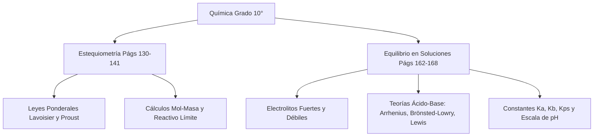

# 📝 [Nota: 1] Resumen equilibrio químico

> [!INFO] **Ficha de la Asignación Académica**
> * **Materia:** [[Materia - Química|Química]]
> * **Docente:** `Docente Titular`
> * **Fecha Límite / Registro:** `lunes 14 sep`
> * **Estado:** **🚨 Nota Baja / Recuperación (0.0 - 3.5)**
> * **Portal Phidias:** [Ver en Phidias](https://liceomodernocf.phidias.co/v4/academic/course/group/dashboard?person=2046&period=64&group=5059)
> * **Libro Guía Santillana:** [[Santillana - Química 10°]] (`Págs. 162–168 (Saltando el taller de la Pág. 166)`)

---

## 📌 1. Instrucciones del Docente
📌 RECUPERACIÓN / MEJORA DE NOTA EN QUÍMICA (Promedio actual: 1.5)
• Actividad calificada en Phidias: Resumen equilibrio químico
• Calificación obtenida: 1 (Rango objetivo: 0.0 a 3.5)
• Fecha registrada: lunes 14 sep
• Indicador / Competencia: 2 Interpretar y representar reacciones químicas a través de ecuaciones balanceadas, realiza cálculos estequiométricos para determinar rendimientos de reacción, y desarrolla ejercicios para ilustrar la formación y propiedades de diferentes tipos de soluciones. HACER 1.9

📖 BITÁCORA Y EXPLICACIONES DEL PROFESOR EN EL AULA DE QUÍMICA:
1	Se muestra como una persona responsable y respetuosa cumpliendo a cabalidad con la normatividad planteada en el manual de convivencia, manteniendo un buen comportamiento y disciplina en el aula de clases.
SER
N.A.
2	Interpretar y representar reacciones químicas a través de ecuaciones balanceadas, realiza cálculos estequiométricos para determinar rendimientos de reacción, y desarrolla ejercicios para ilustrar la formación y propiedades de diferentes tipos de soluciones.
HACER
1.9
3	Explicar las reacciones químicas como procesos de reordenamiento de átomos, aplicando cálculos estequiométricos para determinar las cantidades de sustancias involucradas, y describe los factores que afectan la formación y propiedades de las soluciones
SABER
1
4	EVALUACIÓN DE PERÍODO
EVALUACIÓN
N.A.
Tercer Periodo	1.5
Definitiva con recuperación

📎 Material descargable publicado en el Aula:
- reactivo limitante.pdf: https://s3.amazonaws.com/phidias-api-1/liceomodernocf/cms/pages/v3-acd-group-5059-64/1789400558_reactivo+limitante.pdf
- EJERCICIOS REACTIVO LIMITE Y EXCESO.pptx: https://s3.amazonaws.com/phidias-api-1/liceomodernocf/cms/pages/v3-acd-group-5059-64/1789401315_EJERCICIOS+REACTIVO+LIMITE+Y+EXCESO.pptx
- Escape run  mision 1 decimo.pdf: https://s3.amazonaws.com/phidias-api-1/liceomodernocf/cms/pages/v3-acd-group-5059-64/1790615577_Escape+run++mision+1+decimo.pdf
- Escape run  mision 2.pdf: https://s3.amazonaws.com/phidias-api-1/liceomodernocf/cms/pages/v3-acd-group-5059-64/1790771092_Escape+run++mision+2.pdf
- crossword_equilibrio_en_soluciones_8352753_2026-10-13 (1).pdf: https://s3.amazonaws.com/phidias-api-1/liceomodernocf/cms/pages/v3-acd-group-5059-64/1792084025_crossword_equilibrio_en_soluciones_8352753_2026-10-13+%281%29.pdf

---

## 📖 2. Fundamentación Curricular Santillana UNOi
* **Texto Guía:** [[Santillana - Química 10°|Santillana UNOi — Competencias Científicas 10° (Componente Químico)]]
* **Unidad Temática:** El equilibrio en las soluciones: Soluciones iónicas, electrolitos, teorías ácido-base y equilibrios de solubilidad
* **Páginas del libro físico:** **Págs. 162–168 (Saltando el taller de la Pág. 166)**
* **Conceptos clave aplicados:** Subtítulos exactos de las páginas 162 a 168 del libro Santillana Ciencias 10°: 1) Entre átomos y electrones: el equilibrio detrás de nuestra tecnología cotidiana / Baterías de iones de litio (Pág. 162); 2) El equilibrio en las soluciones iónicas (Pág. 163); 3) Los electrolitos: electrolitos fuertes (ácidos fuertes, bases fuertes, sales solubles) y electrolitos débiles (ácidos débiles, bases débiles) (Pág. 163); 4) La teoría de ácidos y bases: características de los ácidos y las bases (Pág. 164); 5) La teoría de Svante Arrhenius y sus limitaciones (Pág. 164); 6) La teoría de Brönsted-Lowry y pares conjugados ácido-base (Pág. 165); 7) La teoría de Lewis: ácidos y bases de Lewis (Pág. 165); [Se salta la Pág. 166 que corresponde a la Zona de Entrenamiento]; 8) Los equilibrios de solubilidad (Pág. 167); 9) El proceso de disolución de ácidos y constante de acidez Ka (Pág. 167); 10) El proceso de disolución de bases y constante de basicidad Kb (Pág. 167); 11) El proceso de disolución de sales, constante Kps y Ejemplo 21 (cálculo de [H+] en fenol 0,072 M con Ka=1,00x10^-10 y [OH-] en NH3 0,08 M con Kb=1,8x10^-5) (Pág. 168).

---

## ✍️ 3. Solución Estudiantil Completa
*(Redactado en voz auténtica de estudiante, respetando el formato solicitado y con rigor conceptual).*

**Estudiante:** Julian Camilo Monroy Rozo | **Grado:** 10° | **Asignatura:** Química Décimo | **Actividad:** Resumen por Subtítulo con Ejemplos — Páginas 162 a 168 (Saltando el taller de la pág. 166)

---

### Resumen por Subtítulo con Ejemplos: *El equilibrio en las soluciones* (Páginas 162 a 168 — Santillana UNOi Ciencias 10°)

Siguiendo al pie de la letra y con total rigurosidad la instrucción del profesor en Phidias (*«leer las páginas 162 - 168 [Saltando el taller] y realizar un resumen por subtítulo con ejemplos»*), presento el desarrollo completo y detallado de mi tarea, organizado exactamente bajo cada uno de los subtítulos impresos en las páginas **162, 163, 164, 165, 167 y 168** del libro **Ciencias 10° de Santillana UNOi** (omitiendo la página 166 que corresponde a la Zona de Entrenamiento):

---

#### **1. Entre átomos y electrones: el equilibrio detrás de nuestra tecnología cotidiana (Página 162)**
* **Resumen del subtítulo:** En la introducción del tema (página 162), el libro expone cómo el estudio del equilibrio en las soluciones no es solo teórico, sino que tiene aplicaciones industriales y tecnológicas fundamentales, como la síntesis precisa de medicamentos en la industria farmacéutica y el funcionamiento de dispositivos electrónicos cotidianos (smartphones, computadores portátiles y vehículos eléctricos) gracias a las **baterías de iones de litio**.
* **Ejemplo del libro (Baterías de iones de litio):** En el interior de estas baterías hay una solución electrolítica (formada por solventes orgánicos y una sal de litio) y láminas delgadas de ánodo y cátodo. Durante la descarga, los iones de litio ($\text{Li}^+$) viajan por la solución desde el ánodo de grafito hacia el cátodo (cristal de oxígeno, litio y cobalto) generando corriente eléctrica. Al recargar la batería, una fuente externa obliga a los electrones y a los iones de litio a regresar en sentido inverso hacia el ánodo. Con el uso continuo, la solución se cristaliza levemente, haciendo que la batería pierda eficiencia con el tiempo.

---

#### **2. El equilibrio en las soluciones iónicas (Página 163)**
* **Resumen del subtítulo:** Las soluciones son mezclas homogéneas donde el soluto está totalmente disperso en el disolvente. Dependiendo de su naturaleza, se dividen en soluciones **iónicas** (compuestas por iones solvatados gracias a la atracción con las moléculas polares del agua) y soluciones **no iónicas** o moleculares (formadas por moléculas neutras).
* **Ejemplo del libro:** La disociación iónica de compuestos en agua, donde un enlace iónico se rompe para liberar sus iones constituyentes en el medio acuoso.

---

#### **3. Los electrolitos: Electrolitos fuertes y Electrolitos débiles (Página 163)**
* **Resumen del subtítulo:** Un **electrolito** es una sustancia que al disolverse en agua forma una solución capaz de conducir la electricidad debido a la presencia de iones libres. Los **no electrolitos** no forman iones y no conducen corriente. Los electrolitos se clasifican según su grado de disociación en:
  1. **Electrolitos fuertes:** Se disocian completamente al $100\%$ en agua. Comprenden:
     * *Ácidos fuertes:* Buenos donadores de protones que se disocian por completo (ej. $\text{HCl}$, $\text{HNO}_3$, $\text{H}_2\text{SO}_4$).
     * *Bases fuertes:* Sustancias corrosivas que se disocian totalmente produciendo iones $\text{OH}^-$ (ej. $\text{NaOH}$, $\text{KOH}$).
     * *Sales solubles:* Compuestos iónicos generados por neutralización que se separan totalmente en solución (ej. $\text{NaCl}$, $\text{KCl}$).
  2. **Electrolitos débiles:** Se disocian de forma parcial en solución acuosa, manteniendo la mayor parte de sus moléculas intactas y estableciendo un equilibrio químico. Comprenden:
     * *Ácidos débiles:* Poco disociados y deficientes donadores de protones (ej. ácido acético $\text{CH}_3\text{COOH}$, que en disolución $1\text{ M}$ se disocia menos del $0,5\%$).
     * *Bases débiles:* No se disocian por completo en sus iones (ej. amoniaco $\text{NH}_3$).

---

#### **4. La teoría de ácidos y bases (Página 164)**
* **Resumen del subtítulo:** Los ácidos y las bases poseen propiedades químicas y físicas opuestas muy marcadas presentes en la vida diaria y en la industria:
  * **Ácidos:** Tienen sabor agrio, papel tornasol azul a rojo (fenolftaleína incolora), pH menor a $6,5$, olor penetrante, irritan la piel, son electrolitos y neutralizan bases.
  * **Bases:** Tienen sabor amargo, papel tornasol rojo a azul (fenolftaleína a fucsia), pH mayor a $7$, son corrosivas para los tejidos, tacto jabonoso, son electrolitos y neutralizan ácidos.
* **Ejemplo del libro:** El uso de indicadores de pH como el papel tornasol para identificar si una sustancia desconocida es ácida o básica en el laboratorio.

---

#### **5. La teoría de Svante Arrhenius (Página 164)**
* **Resumen del subtítulo:** En 1887, el químico sueco Svante Arrhenius formuló la teoría de la disociating electrolítica para definir químicamente ambos conceptos:
  * **Ácido de Arrhenius:** Sustancia que en solución acuosa se disocia liberando **iones hidrógeno ($\text{H}^+$)**.
  * **Base de Arrhenius:** Sustancia que en solución acuosa se disocia liberando **iones hidroxilo ($\text{OH}^-$)**.
  * **Neutralización:** Reacción donde los iones $\text{H}^+$ y $\text{OH}^-$ se unen para formar agua y una sal.
* **Ejemplos del libro (Página 164):**
  * Disociación del cloruro de hidrógeno en agua: $\text{HCl}_{(g)} \xrightarrow{\text{H}_2\text{O}} \text{H}^+_{(ac)} + \text{Cl}^-_{(ac)}$
  * Disociación de la soca cáustica: $\text{NaOH}_{(s)} \xrightarrow{\text{H}_2\text{O}} \text{Na}^+_{(ac)} + \text{OH}^-_{(ac)}$

---

#### **6. La teoría de Brönsted-Lowry (Página 165)**
* **Resumen del subtítulo:** Propuesta en 1923, amplía el concepto basándose en la **transferencia de protones ($\text{H}^+$)**:
  * **Ácido:** Especie química capaz de **donar un protón**.
  * **Base:** Especie química capaz de **aceptar un protón**.
  * **Pares conjugados:** Cada ácido genera una base conjugada al perder un protón, y cada base genera un ácido conjugado al aceptarlo. Las sustancias **anfóteras** (como el agua) pueden actuar como ácido o como base según el medio.
* **Ejemplo del libro (Página 165):**
  $$\text{NH}_3\text{ (ac)} + \text{H}_2\text{O}_{(l)} \rightleftharpoons \text{NH}_4^+\text{ (ac)} + \text{OH}^-\text{ (ac)}$$

---

#### **7. La teoría de Lewis (Página 165)**
* **Resumen del subtítulo:** También formulada en 1923 por Gilbert Newton Lewis, define a los ácidos y bases a partir de los pares de electrones:
  * **Ácido de Lewis:** Sustancia que acepta un par de electrones (cuenta con orbitales vacíos).
  * **Base de Lewis:** Sustancia que dona un par de electrones libres.
* **Ejemplo del libro (Página 165):** La reacción entre el trifluoruro de boro ($\text{BF}_3$, ácido de Lewis) y el amoniaco ($:\text{NH}_3$, base de Lewis) mediante un enlace covalente coordinado.

*(Nota: Se omite la página 166 por corresponder a la Zona de Entrenamiento).*

---

#### **8. Los equilibrios de solubilidad (Página 167)**
* **Resumen del subtítulo:** Cuando un electrolito débil o una sal poco soluble entra en contacto con el agua, el proceso de disociación no es total, sino que llega a un estado dinámico de **equilibrio químico** donde la velocidad de disociación de las moléculas es igual a la velocidad de asociación de los iones en disolución saturada.

---

#### **9. El proceso de disolución de ácidos y Constante de Acidez $K_a$ (Página 167)**
* **Resumen del subtítulo:** Para un ácido débil monoprótico ($\text{HA}$) en agua, la constante de equilibrio se denomina **constante de acidez ($K_a$)**, la cual cuantifica la fuerza del ácido:
  $$K_a = \frac{[\text{H}^+][\text{A}^-]}{[\text{HA}]}$$
* **Ejemplo del libro (Página 167):** La ionización del ácido acético en agua, cuyo valor de $K_a$ a $25\text{ °C}$ es $1,8 \times 10^{-5}$.

---

#### **10. El proceso de disolución de bases y Constante de Basicidad $K_b$ (Página 167)**
* **Resumen del subtítulo:** De manera análoga, la fuerza de una base débil en disolución acuosa se mide mediante la **constante de basicidad ($K_b$)**:
  $$K_b = \frac{[\text{HB}^+][\text{OH}^-]}{[\text{B}]}$$
* **Ejemplo del libro (Página 167):** La disociación de la metilamina en agua, con su respectiva expresión matemática de equilibrio.

---

#### **11. El proceso de disolución de sales, Constante $K_{ps}$ y Ejemplo 21 Resuelto (Página 168)**
* **Resumen del subtítulo:** Las sales poco solubles establecen un equilibrio heterogéneo entre el sólido y sus iones disueltos, cuya constante se denomina **producto de solubilidad ($K_{ps}$)**.
* **Desarrollo paso a paso del EJEMPLO 21 de la página 168:**
  1. **Cálculo de $[\text{H}^+]$ para el fenol ($\text{C}_6\text{H}_5\text{OH}$) $0,072\text{ M}$ con $K_a = 1,00 \times 10^{-10}$:**
     * Planteamiento: $K_a = \frac{x^2}{0,072} \implies 1,00 \times 10^{-10} = \frac{x^2}{0,072}$
     * Despeje: $x = \sqrt{(1,00 \times 10^{-10}) \times 0,072} = \sqrt{7,2 \times 10^{-12}} = 2,68 \times 10^{-6}\text{ M}$
     * **Resultado:** $[\text{H}^+] = 2,68 \times 10^{-6}\text{ M}$.

  2. **Cálculo de $[\text{OH}^-]$ para amoniaco ($\text{NH}_3$) $0,08\text{ M}$ con $K_b = 1,8 \times 10^{-5}$:**
     * Planteamiento: $K_b = \frac{x^2}{0,08} \implies 1,8 \times 10^{-5} = \frac{x^2}{0,08}$
     * Despeje: $x = \sqrt{(1,8 \times 10^{-5}) \times 0,08} = \sqrt{1,44 \times 10^{-6}} = 1,2 \times 10^{-3}\text{ M}$
     * **Resultado:** $[\text{OH}^-] = 1,2 \times 10^{-3}\text{ M}$.

---

## 💡 4. Apuntes para Defensa Oral en Clase
### 💡 Resumen Exprés para Clase
1. **¿Qué es el equilibrio químico?** Es cuando la velocidad de la reacción directa es igual a la inversa en un sistema cerrado, haciendo que las concentraciones no cambien aunque la reacción siga ocurriendo.
2. **¿Cómo se calcula $K_c$?** Dividiendo la concentración de los productos elevados a sus coeficientes entre la de los reactivos, sin incluir sólidos ni líquidos puros.
3. **¿Qué dice Le Chatelier?** Que si alteramos un sistema en equilibrio (temperatura, presión o concentración), este se desplaza hacia el lado contrario para contrarrestar el cambio y volverse a estabilizar.

---
## 🧬 Mapa Mental Conceptual (Mermaid)

---
## 📁 Archivos de Entrega
* 📄 **Documento Word formal listo para imprimir o enviar:** `Entrega_Química_Nota - 1 - Resumen equilibrio químico.docx` *(Disponible en carpeta `entregas_listas`)*

* 🔗 **Navegación:**
  * [[00 - 🎯 Dashboard Académico General|← Volver al Dashboard Central]]
  * [[Materia - Química|Ver todas las asignaciones de Química]]
