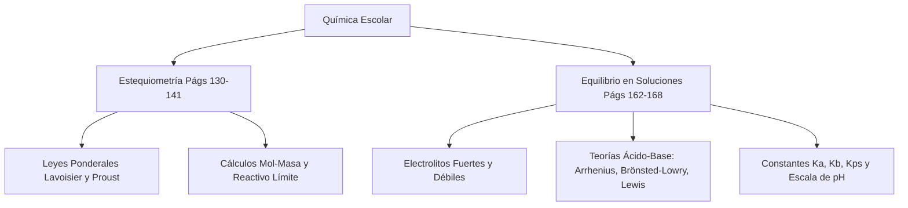

# 📝 [Nota: 1] Taller: pag 166

> [!INFO] **Ficha de la Asignación Académica**
> * **Asignatura:** [[Materia - Química|Química]]
> * **Estudiante Titular:** `Julian Camilo Monroy Rozo`
> * **Docente:** `Docente Titular`
> * **Fecha Límite / Registro:** `miércoles 14 oct`
> * **Estado Académico:** **🚨 Nota Baja / Recuperación (0.0 - 3.5)**
> * **Portal Phidias:** [Ver en Phidias](https://liceomodernocf.phidias.co/v4/academic/course/group/dashboard?person=2046&period=64&group=5059)
> * **Libro Guía Santillana:** [[Santillana - Química 10°]] (`Pág. 166 (con teoría base en Págs. 163–165)`)

---

## 📌 1. Instrucciones del Docente
📌 RECUPERACIÓN / MEJORA DE NOTA EN QUÍMICA (Promedio actual: 1.5)
• Actividad calificada en Phidias: Taller: pag 166
• Calificación obtenida: 1 (Rango objetivo: 0.0 a 3.5)
• Fecha registrada: miércoles 14 oct
• Indicador / Competencia: 3 Explicar las reacciones químicas como procesos de reordenamiento de átomos, aplicando cálculos estequiométricos para determinar las cantidades de sustancias involucradas, y describe los factores que afectan la formación y propiedades de las soluciones SABER 1
• Páginas de Santillana / Libro detectadas: pag 166 1

📖 BITÁCORA Y EXPLICACIONES DEL PROFESOR EN EL AULA DE QUÍMICA:
1	Se muestra como una persona responsable y respetuosa cumpliendo a cabalidad con la normatividad planteada en el manual de convivencia, manteniendo un buen comportamiento y disciplina en el aula de clases.
SER
N.A.
2	Interpretar y representar reacciones químicas a través de ecuaciones balanceadas, realiza cálculos estequiométricos para determinar rendimientos de reacción, y desarrolla ejercicios para ilustrar la formación y propiedades de diferentes tipos de soluciones.
HACER
1.9
3	Explicar las reacciones químicas como procesos de reordenamiento de átomos, aplicando cálculos estequiométricos para determinar las cantidades de sustancias involucradas, y describe los factores que afectan la formación y propiedades de las soluciones
SABER
1
4	EVALUACIÓN DE PERÍODO
EVALUACIÓN
N.A.
Tercer Periodo	1.5
Definitiva con recuperación

📎 Material descargable publicado en el Aula:
- reactivo limitante.pdf: https://s3.amazonaws.com/phidias-api-1/liceomodernocf/cms/pages/v3-acd-group-5059-64/1789400558_reactivo+limitante.pdf
- EJERCICIOS REACTIVO LIMITE Y EXCESO.pptx: https://s3.amazonaws.com/phidias-api-1/liceomodernocf/cms/pages/v3-acd-group-5059-64/1789401315_EJERCICIOS+REACTIVO+LIMITE+Y+EXCESO.pptx
- Escape run  mision 1 decimo.pdf: https://s3.amazonaws.com/phidias-api-1/liceomodernocf/cms/pages/v3-acd-group-5059-64/1790615577_Escape+run++mision+1+decimo.pdf
- Escape run  mision 2.pdf: https://s3.amazonaws.com/phidias-api-1/liceomodernocf/cms/pages/v3-acd-group-5059-64/1790771092_Escape+run++mision+2.pdf
- crossword_equilibrio_en_soluciones_8352753_2026-10-13 (1).pdf: https://s3.amazonaws.com/phidias-api-1/liceomodernocf/cms/pages/v3-acd-group-5059-64/1792084025_crossword_equilibrio_en_soluciones_8352753_2026-10-13+%281%29.pdf

---

## 📖 2. Fundamentación Curricular Santillana UNOi
* **Texto Guía:** [[Santillana - Química 10°|Santillana UNOi — Competencias Científicas 10° (Componente Químico)]]
* **Unidad Temática:** El equilibrio en las soluciones — Zona de Entrenamiento (Pág. 166)
* **Páginas del libro físico:** **Pág. 166 (con teoría base en Págs. 163–165)**
* **Conceptos clave aplicados:** Resolución exacta de los 6 puntos de la ZONA DE ENTRENAMIENTO de la página 166: 1) Clasificar en Ácidos o Bases (HCl, HF, Fe(OH)3, H2CO3, H2SO4, Ca(OH)2, HBr, H3PO4, HNO3, LiOH, Al(OH)3, NaOH, HClO4, NH4OH); 2) Cuatro semejanzas y cuatro diferencias entre ácidos y bases; 3) Verdadero o Falso sobre las 4 afirmaciones de Lewis, electrolitos débiles, bases débiles y HCl; 4) Resumir los 5 tipos de electrolitos (ácidos fuertes, bases fuertes, sales solubles, ácidos débiles, bases débiles) con un ejemplo de cada uno; 5) Completar las 7 ecuaciones de disociación en agua según Arrhenius (HNO3, HBr, H3PO4, H2S, Cr(OH)3, KOH, Pd(OH)4); 6) Selección múltiple sobre las bases según la teoría de Arrhenius (Opción A: aportan iones hidroxilo OH-).

---

## ✍️ 3. Solución Estudiantil Completa
*(Desarrollado en lenguaje auténtico de estudiante, respetando el formato solicitado y con rigor conceptual).*

**Estudiante:** Julian Camilo Monroy Rozo | **Grado:** 10° | **Asignatura:** Química Décimo | **Actividad:** Taller Zona de Entrenamiento — Página 166 (Libro Santillana UNOi Ciencias 10°)

---

### Desarrollo Completo de la Zona de Entrenamiento (Página 166 — Santillana UNOi Ciencias 10°)

Para resolver este taller me basé directamente en la teoría de las **páginas 163, 164 y 165** de nuestro libro de **Ciencias 10° de Santillana UNOi** (*El equilibrio en las soluciones iónicas, Los electrolitos y las Teorías de Ácidos y Bases de Arrhenius, Brönsted-Lowry y Lewis*) y desarrollé en orden los **6 puntos exactos de la Zona de Entrenamiento de la página 166**:

---

#### **Punto 1. Clasifica las siguientes sustancias como ácidos o bases en la tabla.**
*(Sustancias dadas en la página 166 del libro: $\text{HCl}$, $\text{HF}$, $\text{Fe(OH)}_3$, $\text{H}_2\text{CO}_3$, $\text{H}_2\text{SO}_4$, $\text{Ca(OH)}_2$, $\text{HBr}$, $\text{H}_3\text{PO}_4$, $\text{HNO}_3$, $\text{LiOH}$, $\text{Al(OH)}_3$, $\text{NaOH}$, $\text{HClO}_4$, $\text{NH}_4\text{OH}$).*

Siguiendo lo visto en la página 164 sobre la teoría de Arrhenius y Brönsted-Lowry, clasifico las 14 sustancias según cedan iones hidrógeno ($\text{H}^+$) o aporten iones hidroxilo ($\text{OH}^-$) en solución acuosa:

| **Ácidos (Liberan iones $\text{H}^+$ en solución acuosa)** | **Bases (Liberan iones $\text{OH}^-$ en solución acuosa)** |
| :--- | :--- |
| **$\text{HCl}$** — Ácido clorhídrico (ácido fuerte, monoprótico) | **$\text{Fe(OH)}_3$** — Hidróxido de hierro (III) |
| **$\text{HF}$** — Ácido fluorhídrico (ácido débil) | **$\text{Ca(OH)}_2$** — Hidróxido de calcio (base fuerte) |
| **$\text{H}_2\text{CO}_3$** — Ácido carbónico (ácido débil, diprótico) | **$\text{LiOH}$** — Hidróxido de litio (base fuerte) |
| **$\text{H}_2\text{SO}_4$** — Ácido sulfúrico (ácido fuerte, diprótico) | **$\text{Al(OH)}_3$** — Hidróxido de aluminio (base débil) |
| **$\text{HBr}$** — Ácido bromhídrico (ácido fuerte) | **$\text{NaOH}$** — Hidróxido de sodio (base fuerte) |
| **$\text{H}_3\text{PO}_4$** — Ácido fosfórico (ácido débil, triprótico) | **$\text{NH}_4\text{OH}$** — Hidróxido de amonio (base débil) |
| **$\text{HNO}_3$** — Ácido nítrico (ácido fuerte) | — |
| **$\text{HClO}_4$** — Ácido perclórico (ácido fuerte) | — |

---

#### **Punto 2. Escribe cuatro semejanzas y cuatro diferencias entre los ácidos y las bases.**

Con base en el cuadro comparativo de la **página 164 del libro Santillana Ciencias 10°**, organizo las cuatro semejanzas y las cuatro diferencias:

| **Semejanzas entre Ácidos y Bases** | **Diferencias entre Ácidos y Bases** |
| :--- | :--- |
| **1.** Tanto los ácidos como las bases se ionizan o disocian al disolverse en agua formando iones móviles. | **1. Sabor y sensación al tacto:** Los ácidos tienen **sabor agrio** (como el ácido cítrico del limón o el ácido acético del vinagre), mientras que las bases tienen **sabor amargo** y son **jabonosas o resbaladizas al tacto** (como la leche de magnesia o los jabones). |
| **2.** Ambos actúan como **electrolitos en solución acuosa**, por lo que sus disoluciones conducen la corriente eléctrica (con mayor intensidad si son fuertes y menor si son débiles). | **2. Iones producidos según Arrhenius:** Los ácidos aumentan la concentración de iones hidrógeno o hidronio ($\text{H}^+ / \text{H}_3\text{O}^+$) en el agua, mientras que las bases aumentan la concentración de iones hidroxilo ($\text{OH}^-$). |
| **3.** Ambos producen cambios de color característicos cuando entran en contacto con sustancias llamadas **indicadores ácido-base** (como el papel tornasol o la fenolftaleína). | **3. Acción frente a indicadores y metales:** Los ácidos tiñen de **rojo el papel tornasol azul** y reaccionan con metales activos (como $\text{Zn}$ o $\text{Mg}$) liberando gas hidrógeno ($\text{H}_2$); las bases tiñen de **azul el papel tornasol rojo** y reaccionan con grasas (saponificación). |
| **4.** Los ácidos y las bases reaccionan entre sí mediante una **reacción de neutralización**, perdiendo sus propiedades originales para formar una **sal más agua** ($\text{Ácido} + \text{Base} \rightarrow \text{Sal} + \text{H}_2\text{O}$). | **4. Comportamiento protónico y electrónico:** Según Brönsted-Lowry, el ácido **dona protones ($\text{H}^+$)** y la base **acepta protones ($\text{H}^+$)**; según Lewis, el ácido **acepta un par de electrones** y la base **dona un par de electrones**. |

---

#### **Punto 3. Escribe V, si la afirmación es verdadera y F, si es falsa.**

Revisando cada enunciado de la página 166 con las páginas 163 y 165 del libro:

1. **«Un ácido de Lewis es una sustancia capaz de compartir o donar un par de electrones.»** $\rightarrow$ **( F ) Falso.**
   * *Justificación:* Según la teoría de Gilbert Newton Lewis (página 165), la sustancia que posee un par de electrones solitarios para **compartir o donar** es una **base de Lewis** (como el amoniaco $: \text{NH}_3$). El **ácido de Lewis** es el que tiene un orbital vacío y **acepta** el par de electrones (como el $\text{BF}_3$ o el ion $\text{H}^+$).
2. **«Los electrolitos débiles al disolverse en agua permiten encender una bombilla con gran intensidad.»** $\rightarrow$ **( F ) Falso.**
   * *Justificación:* Según la página 163, los electrolitos débiles solo se ionizan de forma parcial (en una proporción muy pequeña) en solución acuosa, por lo que conducen poco la electricidad y la bombilla apenas enciende con una luz muy tenue. Los que la encienden con gran intensidad son los **electrolitos fuertes**.
3. **«Las bases débiles son electrolitos débiles porque se ionizan parcialmente en solución acuosa.»** $\rightarrow$ **( V ) Verdadero.**
   * *Justificación:* Tal como explica la página 163 en la clasificación de electrolitos débiles, las bases débiles (como el amoniaco $\text{NH}_3$) reaccionan parcialmente con el agua estableciendo un equilibrio químico reversible con baja concentración de iones.
4. **«El ácido clorhídrico ($\text{HCl}$) se ioniza totalmente en agua por lo que es un electrolito débil.»** $\rightarrow$ **( F ) Falso.**
   * *Justificación:* El ácido clorhídrico ($\text{HCl}$) sí se ioniza totalmente en agua ($\text{HCl}_{(ac)} \rightarrow \text{H}^+_{(ac)} + \text{Cl}^-_{(ac)}$), pero precisamente por disociarse al 100% es un **electrolito fuerte** (ácido fuerte), no débil.

---

#### **Punto 4. En la lectura anterior se mencionan cinco tipos de electrolitos que existen en la naturaleza. Resúmelos en la tabla que se muestra a continuación y escribe un ejemplo de cada uno.**

De acuerdo con el esquema y las tablas de la **página 163 del libro Santillana Ciencias 10°**, los cinco tipos de electrolitos se dividen en tres electrolitos fuertes y dos electrolitos débiles:

| **Tipo de Electrolito** | **Resumen de sus Características (Pág. 163 Santillana)** | **Ejemplo del Libro** |
| :--- | :--- | :--- |
| **1. Ácidos fuertes** *(Electrolito fuerte)* | Son sustancias moleculares que al disolverse en agua se ionizan prácticamente al 100% de manera irreversible, liberando una alta concentración de iones $\text{H}^+$ y conduciendo muy bien la corriente eléctrica. | Ácido nítrico ($\text{HNO}_3$), ácido sulfúrico ($\text{H}_2\text{SO}_4$) o ácido clorhídrico ($\text{HCl}$). |
| **2. Bases fuertes** *(Electrolito fuerte)* | Son hidróxidos metálicos (generalmente de los grupos IA y IIA) que en solución acuosa se disocian por completo liberando iones metálicos e iones hidroxilo ($\text{OH}^-$). | Hidróxido de sodio ($\text{NaOH}$) o hidróxido de potasio ($\text{KOH}$). |
| **3. Sales solubles** *(Electrolito fuerte)* | Son compuestos iónicos que al entrar en contacto con el agua separan totalmente sus cationes y aniones de la red cristalina, permitiendo un flujo intenso de corriente eléctrica. | Cloruro de sodio ($\text{NaCl}$) o cloruro de potasio ($\text{KCl}$). |
| **4. Ácidos débiles** *(Electrolito débil)* | Son ácidos que en solución acuosa se ionizan solo en una pequeña fracción (menos del 5%), estableciendo un equilibrio dinámico reversible entre las moléculas sin disociar y sus iones. | Ácido acético ($\text{CH}_3\text{COOH}$) o ácido carbónico ($\text{H}_2\text{CO}_3$). |
| **5. Bases débiles** *(Electrolito débil)* | Son compuestos básicos que reaccionan parcialmente con el agua aceptando protones en baja proporción, por lo que producen pocos iones $\text{OH}^-$ y conducen débilmente la electricidad. | Amoniaco ($\text{NH}_3$) o hidróxido de amonio ($\text{NH}_4\text{OH}$). |

---

#### **Punto 5. Completa los productos de la disociación de las siguientes sustancias en agua, de acuerdo con la teoría de Arrhenius.**

Aplicando la teoría de Svante Arrhenius vista en la **página 164** (donde los ácidos se disocian en agua liberando iones $\text{H}^+$ y las bases liberando iones $\text{OH}^-$), completo las 7 ecuaciones químicas exactamente como aparecen en la página 166:

1. **Ácido nítrico:**
   $$\text{HNO}_3\text{ (ac)} \xrightarrow{\text{H}_2\text{O}} \text{H}^+\text{ (ac)} + \text{NO}_3^-\text{ (ac)}$$
2. **Ácido bromhídrico:**
   $$\text{HBr}\text{ (ac)} \xrightarrow{\text{H}_2\text{O}} \text{H}^+\text{ (ac)} + \text{Br}^-\text{ (ac)}$$
3. **Ácido fosfórico (disociación total de sus 3 hidrógenos ácidos):**
   $$\text{H}_3\text{PO}_4\text{ (ac)} \xrightarrow{\text{H}_2\text{O}} 3\text{H}^+\text{ (ac)} + \text{PO}_4^{3-}\text{ (ac)}$$
4. **Ácido sulfhídrico (disociación de sus 2 hidrógenos ácidos):**
   $$\text{H}_2\text{S}\text{ (ac)} \xrightarrow{\text{H}_2\text{O}} 2\text{H}^+\text{ (ac)} + \text{S}^{2-}\text{ (ac)}$$
5. **Hidróxido de cromo (III):**
   $$\text{Cr(OH)}_3\text{ (ac)} \xrightarrow{\text{H}_2\text{O}} \text{Cr}^{3+}\text{ (ac)} + 3\text{OH}^-\text{ (ac)}$$
6. **Hidróxido de potasio:**
   $$\text{KOH}\text{ (ac)} \xrightarrow{\text{H}_2\text{O}} \text{K}^+\text{ (ac)} + \text{OH}^-\text{ (ac)}$$
7. **Hidróxido de paladio (IV):**
   $$\text{Pd(OH)}_4\text{ (ac)} \xrightarrow{\text{H}_2\text{O}} \text{Pd}^{4+}\text{ (ac)} + 4\text{OH}^-\text{ (ac)}$$

---

#### **Punto 6. De acuerdo con la teoría de Arrhenius es correcto afirmar que las bases son aquellas sustancias que:**
* **A.** aportan iones hidroxilo a la solución.
* **B.** aceptan protones.
* **C.** aportan protones a la solución.
* **D.** donan electrones.

**Respuesta correcta: Opción A (aportan iones hidroxilo a la solución).**

**Justificación:** Según lo estudiado en la **página 164**, Svante Arrhenius definió una base como toda sustancia eléctricamente neutra que en disolución acuosa se disocia liberando **iones hidroxilo ($\text{OH}^-$)**, aumentando su concentración en el agua. (Aceptar protones corresponde a la definición de Brönsted-Lowry y donar pares de electrones a la de Lewis).

---

## 💡 4. Apuntes para Defensa Oral en Clase
### 💡 Resumen Exprés para Clase
1. **Balancear primero:** Nunca se puede iniciar un cálculo estequiométrico sin antes comprobar que la ecuación cumple con la ley de conservación de la masa.
2. **Uso de moles:** Para hallar el reactivo limitante, siempre es obligatorio pasar los gramos a moles y dividir entre el coeficiente de la ecuación; el menor resultado manda.
3. **El producto depende del límite:** La cantidad teórica máxima de producto que se obtiene en una reacción química siempre se calcula exclusivamente a partir del reactivo limitante.

---
## 🧬 Mapa Mental Conceptual (Mermaid)

---
## 📁 Archivos de Entrega
* 📄 **Documento Word formal listo para imprimir o enviar:** `Entrega_Química_Nota - 1 - Taller - pag 166.docx` *(Disponible en carpeta `entregas_listas`)*

* 🔗 **Navegación:**
  * [[00 - 🎯 Dashboard Académico General|← Volver al Dashboard Central]]
  * [[Materia - Química|Ver todas las asignaciones de Química]]
