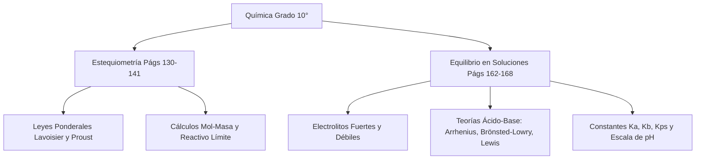

# 📝 Resumen por Subtítulo con Ejemplos (páginas 162 - 168)

> [!INFO] **Ficha de la Asignación Académica**
> * **Materia:** [[Materia - Química|Química]]
> * **Docente:** `Docente Titular`
> * **Fecha Límite / Registro:** `Clase, miércoles 14 octubre 23:59`
> * **Estado:** **🔴 Atrasadas (Semana pasada)**
> * **Portal Phidias:** [Ver en Phidias](https://liceomodernocf.phidias.co/academic/assignment/details?assignment=12001&person=2046&_ach=07fbce70885bf1d060fad09befa77e8f)
> * **Libro Guía Santillana:** [[Santillana - Química 10°]] (`Págs. 162–168 (Saltando el taller de la Pág. 166)`)

---

## 📌 1. Instrucciones del Docente
Buenas tardes estimados estudiantes. Por favor leer las páginas 162 - 168 [Saltando el taller] y realizar un resumen por subtítulo con ejemplos. No dejen la actividad para última hora, corrijan ese hábito. En clase sólo responderé preguntas y haré taller sobre el tema. Feliz tarde.

---

## 📖 2. Fundamentación Curricular Santillana UNOi
* **Texto Guía:** [[Santillana - Química 10°|Santillana UNOi — Competencias Científicas 10° (Componente Químico)]]
* **Unidad Temática:** El equilibrio en las soluciones: Soluciones iónicas, electrolitos, teorías ácido-base y equilibrios de solubilidad
* **Páginas del libro físico:** **Págs. 162–168 (Saltando el taller de la Pág. 166)**
* **Conceptos clave aplicados:** Subtítulos exactos de las páginas 162 a 168 del libro Santillana Ciencias 10°: 1) Entre átomos y electrones: el equilibrio detrás de nuestra tecnología cotidiana / Baterías de iones de litio (Pág. 162); 2) El equilibrio en las soluciones iónicas (Pág. 163); 3) Los electrolitos: electrolitos fuertes (ácidos fuertes, bases fuertes, sales solubles) y electrolitos débiles (ácidos débiles, bases débiles) (Pág. 163); 4) La teoría de ácidos y bases: características de los ácidos y las bases (Pág. 164); 5) La teoría de Svante Arrhenius y sus limitaciones (Pág. 164); 6) La teoría de Brönsted-Lowry y pares conjugados ácido-base (Pág. 165); 7) La teoría de Lewis: ácidos y bases de Lewis (Pág. 165); [Se salta la Pág. 166 que corresponde a la Zona de Entrenamiento]; 8) Los equilibrios de solubilidad (Pág. 167); 9) El proceso de disolución de ácidos y constante de acidez Ka (Pág. 167); 10) El proceso de disolución de bases y constante de basicidad Kb (Pág. 167); 11) El proceso de disolución de sales, constante Kps y Ejemplo 21 (cálculo de [H+] en fenol 0,072 M con Ka=1,00x10^-10 y [OH-] en NH3 0,08 M con Kb=1,8x10^-5) (Pág. 168).

---

## ✍️ 3. Solución Estudiantil Completa
*(Redactado en voz auténtica de estudiante, respetando el formato solicitado y con rigor conceptual).*

**Estudiante:** Julian Camilo Monroy Rozo | **Grado:** 10° | **Asignatura:** Química Décimo | **Actividad:** Resumen por Subtítulo con Ejemplos — Páginas 162 a 168 (Saltando el taller de la pág. 166)

---

### Resumen por Subtítulo con Ejemplos: *El equilibrio en las soluciones* (Páginas 162 a 168 — Santillana UNOi Ciencias 10°)

Siguiendo al pie de la letra la instrucción del profesor en Phidias (*«leer las páginas 162 - 168 [Saltando el taller] y realizar un resumen por subtítulo con ejemplos»*), organizo mi resumen respetando exactamente cada uno de los subtítulos impresos en las páginas **162, 163, 164, 165, 167 y 168** del libro **Ciencias 10° de Santillana UNOi** (saltando la página 166 que corresponde a la Zona de Entrenamiento):

---

#### **1. Entre átomos y electrones: el equilibrio detrás de nuestra tecnología cotidiana (Página 162)**
* **Resumen del subtítulo:** En la apertura del tema (página 162), el libro explica cómo los procesos de disociación iónica y el equilibrio en soluciones químicas permiten el funcionamiento de dispositivos electrónicos modernos como teléfonos celulares, computadores portátiles y vehículos eléctricos. Estos equipos dependen del movimiento controlado de iones a través de un medio conductor llamado **electrolito**.
* **Ejemplo del libro (Baterías de iones de litio):** En una batería recargable de iones de litio, los iones $\text{Li}^+$ viajan a través de una solución electrolítica desde el **ánodo** (electrodo negativo de grafito) hacia el **cátodo** (electrodo positivo de óxido de litio y cobalto $\text{LiCoO}_2$) durante la descarga para generar corriente eléctrica, y regresan en sentido inverso cuando conectamos el celular al cargador, manteniendo un equilibrio electroquímico reversible.

---

#### **2. El equilibrio en las soluciones iónicas (Página 163)**
* **Resumen del subtítulo:** Muchas reacciones químicas ocurren en disolución acuosa, donde el agua ($\text{H}_2\text{O}$), gracias a su naturaleza polar, rodea y separa los iones de un soluto mediante el proceso de **solvatación o disociación electrolítica**. Cuando un soluto iónico o polar se disuelve en agua, puede disociarse por completo (proceso irreversible) o establecer un **equilibrio iónico dinámico** (proceso reversible $\rightleftharpoons$) entre las moléculas sin disociar y los iones libres en la solución.
* **Ejemplo del libro:** Al disolver cloruro de sodio en agua, las moléculas polares del agua rodean a los cationes $\text{Na}^+$ y a los aniones $\text{Cl}^-$, separándolos en la solución:
  $$\text{NaCl}_{(s)} \xrightarrow{\text{H}_2\text{O}} \text{Na}^+_{(ac)} + \text{Cl}^-_{(ac)}$$

---

#### **3. Los electrolitos: Electrolitos fuertes y Electrolitos débiles (Página 163)**
* **Resumen del subtítulo:** Un **electrolito** es toda sustancia que al disolverse en agua forma una disolución capaz de conducir la corriente eléctrica debido a la presencia de iones libres en movimiento. Las sustancias que se disuelven en agua pero no forman iones (como la glucosa o la sacarosa) son **no electrolitos** y no conducen la electricidad. Según su grado de disociación en agua, los electrolitos se dividen en dos grandes grupos y cinco subtipos:
  1. **Electrolitos fuertes:** Se disocian prácticamente al $100\%$ en solución acuosa (se representan con una sola flecha $\rightarrow$), generando una alta concentración de iones y encendiendo una bombilla con gran intensidad. Comprenden:
     * **Ácidos fuertes:** Se ionizan totalmente liberando iones $\text{H}^+$.
     * **Bases fuertes:** Hidróxidos metálicos que se disocian al $100\%$ liberando iones $\text{OH}^-$.
     * **Sales solubles:** Compuestos iónicos que se separan completamente en cationes y aniones en el agua.
  2. **Electrolitos débiles:** Se ionizan solo de manera parcial (generalmente menos del $5\%$) estableciendo un equilibrio químico reversible ($\rightleftharpoons$) entre las moléculas neutras y los iones. Conducen muy poco la electricidad (la bombilla enciende con luz tenue). Comprenden:
     * **Ácidos débiles:** Liberan una fracción muy pequeña de iones $\text{H}^+$.
     * **Bases débiles:** Aceptan protones o producen iones $\text{OH}^-$ en muy baja proporción.
* **Ejemplos reales de las tablas de la página 163:**
  * *Ejemplo de ácido fuerte:* Ácido nítrico ($\text{HNO}_3$), ácido sulfúrico ($\text{H}_2\text{SO}_4$) y ácido clorhídrico ($\text{HCl}$).
  * *Ejemplo de base fuerte:* Hidróxido de sodio ($\text{NaOH}$) e hidróxido de potasio ($\text{KOH}$):
    $$\text{NaOH}_{(s)} \xrightarrow{\text{H}_2\text{O}} \text{Na}^+_{(ac)} + \text{OH}^-_{(ac)}$$
  * *Ejemplo de sal soluble:* Cloruro de potasio ($\text{KCl}$):
    $$\text{KCl}_{(s)} \xrightarrow{\text{H}_2\text{O}} \text{K}^+_{(ac)} + \text{Cl}^-_{(ac)}$$
  * *Ejemplo de ácido débil:* Ácido acético ($\text{CH}_3\text{COOH}$) presente en el vinagre y ácido carbónico ($\text{H}_2\text{CO}_3$):
    $$\text{CH}_3\text{COOH}_{(ac)} \rightleftharpoons \text{H}^+_{(ac)} + \text{CH}_3\text{COO}^-_{(ac)}$$
  * *Ejemplo de base débil:* Amoniaco ($\text{NH}_3$) en agua:
    $$\text{NH}_3\text{ (g)} + \text{H}_2\text{O}_{(l)} \rightleftharpoons \text{NH}_4^+\text{ (ac)} + \text{OH}^-\text{ (ac)}$$

---

#### **4. La teoría de ácidos y bases (Página 164)**
* **Resumen del subtítulo:** Los ácidos y las bases son dos grupos de compuestos químicos con propiedades opuestas muy definidas que han sido estudiados desde la antigüedad:
  * **Características de los ácidos:** Tienen sabor agrio, cambian el papel tornasol de azul a rojo, reaccionan con metales activos (como el zinc o el magnesio) desprendiendo gas hidrógeno ($\text{H}_2$), reaccionan con carbonatos liberando $\text{CO}_2$ y conducen la electricidad en solución acuosa.
  * **Características de las bases (o álcalis):** Tienen sabor amargo, sensación jabonosa o resbaladiza al tacto, cambian el papel tornasol de rojo a azul, disuelven grasas y aceites, y neutralizan la acción de los ácidos.
* **Ejemplo del libro:** El jugo de limón (ácido cítrico) y el vinagre (ácido acético) son ácidos cotidianos, mientras que la leche de magnesia ($\text{Mg(OH)}_2$, usada como antiácido estomacal) y los limpiadores con amoniaco son bases.

---

#### **5. La teoría de Svante Arrhenius (Página 164)**
* **Resumen del subtítulo:** En 1884, el químico sueco **Svante Arrhenius** propuso la primera definición iónica de ácidos y bases basada en la disociación electrolítica en agua:
  * **Ácido de Arrhenius:** Sustancia eléctricamente neutra que en disolución acuosa se disocia produciendo **iones hidrógeno ($\text{H}^+$)**.
  * **Base de Arrhenius:** Sustancia que en disolución acuosa se disocia produciendo **iones hidroxilo ($\text{OH}^-$)**.
  * **Neutralización según Arrhenius:** Cuando reaccionan un ácido y una base, los iones $\text{H}^+$ y $\text{OH}^-$ se combinan para formar agua ($\text{H}^+ + \text{OH}^- \rightarrow \text{H}_2\text{O}$), además de una sal.
  * **Limitaciones de la teoría de Arrhenius:** Solo se aplica a disoluciones acuosas (en agua), no explica por qué compuestos que no tienen grupos $\text{OH}^-$ en su fórmula (como el amoniaco $\text{NH}_3$ o el carbonato de sodio $\text{Na}_2\text{CO}_3$) se comportan como bases, ni considera que el ion $\text{H}^+$ libre se une inmediatamente a una molécula de agua formando el **ion hidronio ($\text{H}_3\text{O}^+$)**.
* **Ejemplos del libro (Página 164):**
  * *Disociación de un ácido monoprótico y diprótico:*
    $$\text{HCl}_{(g)} \xrightarrow{\text{H}_2\text{O}} \text{H}^+_{(ac)} + \text{Cl}^-_{(ac)} \qquad ; \qquad \text{H}_2\text{SO}_4\text{ (l)} \xrightarrow{\text{H}_2\text{O}} 2\text{H}^+_{(ac)} + \text{SO}_4^{2-}\text{ (ac)}$$
  * *Disociación de una base y neutralización:*
    $$\text{NaOH}_{(s)} \xrightarrow{\text{H}_2\text{O}} \text{Na}^+_{(ac)} + \text{OH}^-_{(ac)}$$
    $$\text{HCl}_{(ac)} + \text{NaOH}_{(ac)} \longrightarrow \text{NaCl}_{(ac)} + \text{H}_2\text{O}_{(l)}$$

---

#### **6. La teoría de Brönsted-Lowry (Página 165)**
* **Resumen del subtítulo:** En 1923, Johannes Brönsted y Thomas Lowry formularon de manera independiente una teoría más general basada en la **transferencia de protones ($\text{H}^+$)** que aplica tanto en agua como en otros solventes:
  * **Ácido de Brönsted-Lowry:** Toda especie química (molécula o ion) capaz de **donar o ceder un protón ($\text{H}^+$)**.
  * **Base de Brönsted-Lowry:** Toda especie química capaz de **aceptar o recibir un protón ($\text{H}^+$)** (para lo cual requiere tener al menos un par de electrones libres).
  * **Pares conjugados ácido-base:** Cuando un ácido dona un protón, se transforma en su **base conjugada**; cuando una base acepta un protón, se transforma en su **ácido conjugado**.
  * **Sustancias anfóteras (o anfipróticas):** Sustancias como el agua ($\text{H}_2\text{O}$) que pueden actuar como ácido frente a una base (como el $\text{NH}_3$) y como base frente a un ácido (como el $\text{HCl}$).
* **Ejemplos del libro (Página 165):**
  * *Ejemplo 1 (Amoniaco en agua — el agua actúa como ácido):*
    $$\underset{\text{Base 1}}{\text{NH}_3\text{ (ac)}} + \underset{\text{Ácido 2}}{\text{H}_2\text{O}_{(l)}} \rightleftharpoons \underset{\text{Ácido conjugado 1}}{\text{NH}_4^+\text{ (ac)}} + \underset{\text{Base conjugada 2}}{\text{OH}^-\text{ (ac)}}$$
  * *Ejemplo 2 (Ácido clorhídrico en agua — el agua actúa como base):*
    $$\underset{\text{Ácido 1}}{\text{HCl}_{(ac)}} + \underset{\text{Base 2}}{\text{H}_2\text{O}_{(l)}} \longrightarrow \underset{\text{Ácido conjugado 2}}{\text{H}_3\text{O}^+\text{ (ac)}} + \underset{\text{Base conjugada 1}}{\text{Cl}^-\text{ (ac)}}$$

---

#### **7. La teoría de Lewis (Página 165)**
* **Resumen del subtítulo:** También en 1923, el químico estadounidense **Gilbert Newton Lewis** propuso una definición aún más amplia basada en la estructura electrónica y el enlace covalente coordinado (dativo), sin necesidad de que haya transferencia de protones $\text{H}^+$:
  * **Ácido de Lewis:** Sustancia (átomo, molécula o ion) que tiene un orbital atómico o molecular vacío y puede **aceptar un par de electrones**.
  * **Base de Lewis:** Sustancia que posee al menos un par de electrones no compartidos (solitarios) y puede **donar o compartir ese par de electrones** para formar un enlace covalente coordinado.
* **Ejemplo del libro (Página 165):**
  * Reacción entre el trifluoruro de boro ($\text{BF}_3$, donde el boro tiene el octeto incompleto con un orbital vacío, actuando como **ácido de Lewis**) y el amoniaco ($: \text{NH}_3$, donde el nitrógeno posee un par libre de electrones, actuando como **base de Lewis**):
    $$\underset{\text{Ácido de Lewis}}{\text{BF}_3} + \underset{\text{Base de Lewis}}{:\text{NH}_3} \longrightarrow \text{F}_3\text{B}\longleftarrow\text{NH}_3$$

*(Nota: Se salta la página 166 porque corresponde a la Zona de Entrenamiento, tal como indicó el profesor en la asignación).*

---

#### **8. Los equilibrios de solubilidad (Página 167)**
* **Resumen del subtítulo:** Cuando un electrolito débil (un ácido débil, una base débil o una sal poco soluble) se disuelve en agua, el proceso de disociación es reversible y alcanza un estado de **equilibrio químico de solubilidad o disociación**. A una temperatura constante, la velocidad a la que las moléculas se disocian en iones se iguala con la velocidad a la que los iones vuelven a unirse, y la relación entre sus concentraciones molares se expresa mediante una constante de equilibrio ($K_a$, $K_b$ o $K_{ps}$).
* **Ejemplo del libro:** La disolución parcial de electrolitos débiles en agua donde coexisten en equilibrio las especies moleculares y las especies iónicas.

---

#### **9. El proceso de disolución de ácidos y Constante de Acidez $K_a$ (Página 167)**
* **Resumen del subtítulo:** Cuando un ácido débil monoprótico ($\text{HA}$) se disuelve en agua, se ioniza parcialmente según la ecuación general:
  $$\text{HA}_{(ac)} + \text{H}_2\text{O}_{(l)} \rightleftharpoons \text{H}_3\text{O}^+_{(ac)} + \text{A}^-_{(ac)} \quad \text{o simplemente} \quad \text{HA}_{(ac)} \rightleftharpoons \text{H}^+_{(ac)} + \text{A}^-_{(ac)}$$
  Como la concentración del agua líquida permanece prácticamente constante, la ley de acción de masas define la **constante de disociación ácida o constante de acidez ($K_a$)**:
  $$K_a = \frac{[\text{H}^+][\text{A}^-]}{[\text{HA}]}$$
  Cuanto mayor sea el valor de $K_a$, más fuerte es el ácido; cuanto menor sea $K_a$, más débil es el ácido y menor es su porcentaje de ionización.
* **Ejemplo del libro (Página 167):** Ionización del ácido acético ($\text{HC}_2\text{H}_3\text{O}_2$) en agua a $25\text{ °C}$:
  $$\text{HC}_2\text{H}_3\text{O}_2\text{ (ac)} \rightleftharpoons \text{H}^+\text{ (ac)} + \text{C}_2\text{H}_3\text{O}_2^-\text{ (ac)} \qquad \Rightarrow \qquad K_a = \frac{[\text{H}^+][\text{C}_2\text{H}_3\text{O}_2^-]}{[\text{HC}_2\text{H}_3\text{O}_2]} = 1,8 \times 10^{-5}$$

---

#### **10. El proceso de disolución de bases y Constante de Basicidad $K_b$ (Página 167)**
* **Resumen del subtítulo:** De forma análoga, cuando una base débil ($\text{B}$) se disuelve en agua, acepta un protón del agua de manera parcial formando su ácido conjugado ($\text{HB}^+$) e iones hidroxilo ($\text{OH}^-$):
  $$\text{B}_{(ac)} + \text{H}_2\text{O}_{(l)} \rightleftharpoons \text{HB}^+_{(ac)} + \text{OH}^-_{(ac)}$$
  La medida cuantitativa de la fuerza de una base débil está dada por su **constante de disociación básica o constante de basicidad ($K_b$)**:
  $$K_b = \frac{[\text{HB}^+][\text{OH}^-]}{[\text{B}]}$$
* **Ejemplo del libro (Página 167):** Ionización de la metilamina ($\text{CH}_3\text{NH}_2$) en agua:
  $$\text{CH}_3\text{NH}_2\text{ (ac)} + \text{H}_2\text{O}_{(l)} \rightleftharpoons \text{CH}_3\text{NH}_3^+\text{ (ac)} + \text{OH}^-\text{ (ac)} \qquad \Rightarrow \qquad K_b = \frac{[\text{CH}_3\text{NH}_3^+][\text{OH}^-]}{[\text{CH}_3\text{NH}_2]} = 4,4 \times 10^{-4}$$

---

#### **11. El proceso de disolución de sales, Constante $K_{ps}$ y Ejemplo 21 Resuelto (Página 168)**
* **Resumen del subtítulo:** Cuando una sal poco soluble (como el sulfato de bario o el cloruro de plata) se pone en contacto con agua, se establece un equilibrio heterogéneo entre el sólido no disuelto y los iones en la solución saturada:
  $$\text{A}_n\text{B}_m\text{ (s)} \rightleftharpoons n\text{A}^{m+}\text{ (ac)} + m\text{B}^{n-}\text{ (ac)}$$
  Como la concentración del sólido puro es constante, el equilibrio se expresa mediante la **constante del producto de solubilidad ($K_{ps}$)**:
  $$K_{ps} = [\text{A}^{m+}]^n \cdot [\text{B}^{n-}]^m$$
  * *Ejemplos de expresiones de $K_{ps}$ de la página 168:*
    * Sulfato de bario: $\text{BaSO}_4\text{ (s)} \rightleftharpoons \text{Ba}^{2+}\text{ (ac)} + \text{SO}_4^{2-}\text{ (ac)} \Rightarrow K_{ps} = [\text{Ba}^{2+}][\text{SO}_4^{2-}]$
    * Fosfato de calcio: $\text{Ca}_3(\text{PO}_4)_2\text{ (s)} \rightleftharpoons 3\text{Ca}^{2+}\text{ (ac)} + 2\text{PO}_4^{3-}\text{ (ac)} \Rightarrow K_{ps} = [\text{Ca}^{2+}]^3[\text{PO}_4^{3-}]^2$

* **Desarrollo paso a paso del EJEMPLO 21 de la página 168 del libro:**
  1. **Ejercicio 1 del Ejemplo 21 (Cálculo con $K_a$):** *Calcular la concentración de iones hidrógeno $[\text{H}^+]$ en una solución $0,072\text{ M}$ de fenol ($\text{C}_6\text{H}_5\text{OH}$), sabiendo que su constante de acidez es $K_a = 1,00 \times 10^{-10}$.*
     * **Ecuación de ionización:** $\text{C}_6\text{H}_5\text{OH}_{(ac)} \rightleftharpoons \text{H}^+_{(ac)} + \text{C}_6\text{H}_5\text{O}^-_{(ac)}$
     * **Planteamiento del equilibrio:** En el equilibrio, $[\text{H}^+] = [\text{C}_6\text{H}_5\text{O}^-] = x$, y como $K_a$ es muy pequeña, $[\text{C}_6\text{H}_5\text{OH}] = 0,072 - x \approx 0,072\text{ M}$.
     * **Sustitución y despeje:**
       $$K_a = \frac{[\text{H}^+][\text{C}_6\text{H}_5\text{O}^-]}{[\text{C}_6\text{H}_5\text{OH}]} \implies 1,00 \times 10^{-10} = \frac{x^2}{0,072}$$
       $$x = \sqrt{(1,00 \times 10^{-10}) \times 0,072} = \sqrt{7,2 \times 10^{-12}} = 2,68 \times 10^{-6}\text{ M}$$
     * **Respuesta:** La concentración de iones hidrógeno es $[\text{H}^+] = 2,68 \times 10^{-6}\text{ M}$.

  2. **Ejercicio 2 del Ejemplo 21 (Cálculo con $K_b$):** *Calcular la concentración de iones hidroxilo $[\text{OH}^-]$ en una solución de amoniaco ($\text{NH}_3$) $0,08\text{ M}$, sabiendo que $K_b = 1,8 \times 10^{-5}$.*
     * **Ecuación de ionización:** $\text{NH}_3\text{ (ac)} + \text{H}_2\text{O}_{(l)} \rightleftharpoons \text{NH}_4^+\text{ (ac)} + \text{OH}^-\text{ (ac)}$
     * **Planteamiento del equilibrio:** Sea $[\text{NH}_4^+] = [\text{OH}^-] = x$, y $[\text{NH}_3] = 0,08 - x \approx 0,08\text{ M}$.
     * **Sustitución y despeje:**
       $$K_b = \frac{[\text{NH}_4^+][\text{OH}^-]}{[\text{NH}_3]} \implies 1,8 \times 10^{-5} = \frac{x^2}{0,08}$$
       $$x = \sqrt{(1,8 \times 10^{-5}) \times 0,08} = \sqrt{1,44 \times 10^{-6}} = 1,2 \times 10^{-3}\text{ M}$$
     * **Respuesta:** La concentración de iones hidroxilo en el equilibrio es $[\text{OH}^-] = 1,2 \times 10^{-3}\text{ M}$.

---

## 💡 4. Apuntes para Defensa Oral en Clase
### 💡 Resumen Exprés para Clase
1. **¿Qué es una solución?** Es una mezcla homogénea donde un soluto se dispersa de manera uniforme dentro de un solvente sin alterar su composición química básica.
2. **¿Qué factores alteran la solubilidad?** Principalmente la temperatura (si sube, se disuelven más sólidos) y la presión (si sube, se disuelven más gases en líquidos).
3. **¿Cuál es la diferencia entre Molaridad y Molalidad?** La Molaridad ($M$) relaciona las moles de soluto con los litros de *solución* total, mientras que la Molalidad ($m$) relaciona las moles de soluto con los kilogramos netos de *solvente*.

---
## 🧬 Mapa Mental Conceptual (Mermaid)

---
## 📁 Archivos de Entrega
* 📄 **Documento Word formal listo para imprimir o enviar:** `Entrega_Química_Resumen por Subtítulo con Ejemplos (páginas 162 - 168).docx` *(Disponible en carpeta `entregas_listas`)*

* 🔗 **Navegación:**
  * [[00 - 🎯 Dashboard Académico General|← Volver al Dashboard Central]]
  * [[Materia - Química|Ver todas las asignaciones de Química]]
